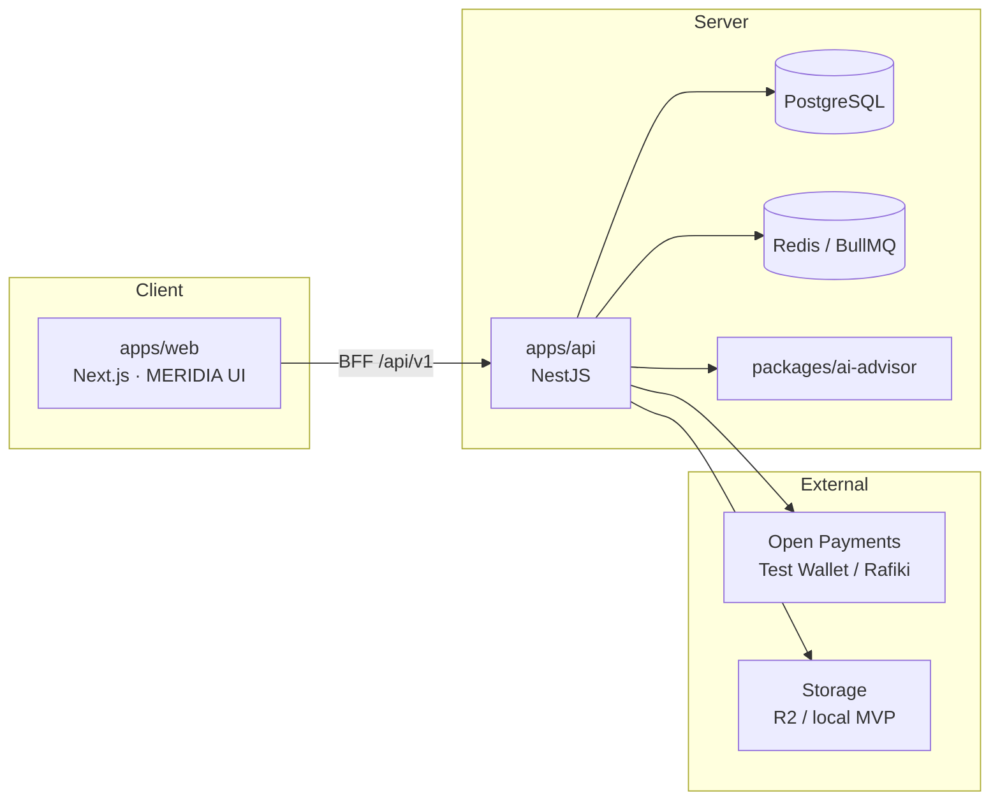

# MERIDIA

Marketplace de servicios digitales y encargos para América, con **custodia de fondos (escrow)** sobre [Open Payments](https://openpayments.dev/) e [Interledger](https://interledger.org/), comisión fija **96 % Freelancer / 4 % plataforma**, y un **Consejero de IA** consultivo (imagen y texto en el MVP).

> **Nombre de producto:** MERIDIA  
> **Código / monorepo:** TaskStream AI (`Haki-Soft`)  
> **Hackathon:** [Interledger Hackathon](https://interledger.org/es/hackathon/overview/) — política de IA documentada en [`AI_USAGE.md`](./AI_USAGE.md)

---

## ¿Qué resuelve?

Contratistas y freelancers en el continente americano suelen pagar comisiones altas (10–20 %) y esperar días o semanas por liquidaciones bancarias. MERIDIA:

1. Conecta **Cliente** y **Freelancer** en un marketplace híbrido (Gigs a precio fijo + publicaciones con bandeja de ofertas).
2. Bloquea el **100 %** del presupuesto acordado en una billetera de custodia (escrow) vía Open Payments / GNAP.
3. Libera en un solo desembolso **96 %** al Freelancer y **4 %** a la wallet del dueño de la plataforma (o reembolsa **100 %** si el ciclo falla).
4. Audita de forma consultiva entregas de **imagen y texto** con el Consejero de IA (sin decidir el pago por sí solo).

---

## Equipo

Célula de **5 desarrolladores** (2 Frontend / 2 Backend / 1 IA), según [`.agents/CONTEXT.md`](./.agents/CONTEXT.md):

| Rol | Enfoque |
| --- | --- |
| **FE-1** | Marketplace, negociación, custodia UI, plazos y actividad |
| **FE-2** | Experiencia visual (GSAP / ScrollTrigger / Lenis), previews protegidos |
| **BE-1** | Open Payments, escrow, liberación 96/4, reembolsos (IA mínima/nula en el core) |
| **BE-2** | Prisma/PostgreSQL, storage, workers, relojes BullMQ |
| **AI-1** | Contratos y orquestación del Consejero de IA (`packages/ai-advisor`) |

### Integrantes (GitHub)

| Persona | GitHub |
| --- | --- |
| Sebastián Tunjuelo | [@Sebastian-Tunjuelo](https://github.com/Sebastian-Tunjuelo) |
| Samuel Duque | [@Samuel-Duque](https://github.com/Samuel-Duque) |
| George AMS | [@GeorgeAMS](https://github.com/GeorgeAMS) |
| Sara M. Lopera | [@SaraMLopera](https://github.com/SaraMLopera) |
| Maicol D. | [@MaicolD0930](https://github.com/MaicolD0930) |

Repositorio: [`Sebastian-Tunjuelo/Haki-Soft`](https://github.com/Sebastian-Tunjuelo/Haki-Soft)

---

## Arquitectura

Monorepo **pnpm + Turborepo**:

```text
Haki-Soft/
├── apps/
│   ├── web/          # Next.js 15.5 + React 19 — UI MERIDIA
│   └── api/          # NestJS 10 + Prisma 6 — dominio, escrow, OP
├── packages/
│   ├── shared-schemas/   # Contratos Zod compartidos
│   └── ai-advisor/       # Consejero IA (imagen / texto)
├── planning/         # Arquitectura, taskboard, plan UI Meridia
├── specs/            # SPEC-00 … SPEC-12 (SDD + BDD)
├── tools/            # CLI / MCP Open Payments
└── prompts/          # Trazabilidad de prompts (hackathon)
```

| Capa | Stack |
| --- | --- |
| Frontend | Next.js 15.5, React 19, GSAP + ScrollTrigger + Lenis, diseño MERIDIA (claro/oscuro) |
| Backend | NestJS 10.4, Prisma 6, PostgreSQL, Redis / BullMQ (relojes) |
| Pagos | `@interledger/open-payments`, Test Wallet / Rafiki, GNAP |
| IA | Vercel AI SDK + proveedor (p. ej. Groq); alcance MVP = imagen y texto |
| Infra local | Docker Compose (Postgres `:5433`, Redis) |

### Vista de componentes



### Flujo financiero (resumen)

1. Cliente solicita / Freelancer acepta (ventana **24 h**; sin movimiento de fondos aún).
2. Cliente autoriza GNAP → **100 %** a wallet de custodia → `ESCROW_LOCKED` + reloj **7 días**.
3. Entrega → revisión **32 h** (máx. **2** correcciones) → ventana final **30 min**.
4. Liberación **96 % / 4 %**, o reembolso **100 %** (actividad muere; no hay reapertura de la misma orden).

Detalle y máquina de estados: [`planning/architecture-overview.md`](./planning/architecture-overview.md).

### Reglas de negocio inmutables

- Pago único (sin hitos ni fraccionamiento).
- Comisión plana **4 %** (desembolso 96/4 a wallets distintas del escrow).
- Una sola wallet activa verificada por usuario.
- Cuenta unificada: el mismo usuario puede contratar y ofrecer servicios (sin página de “Modo”).
- FX doble asumido por el Cliente (Buyer).
- IA del MVP solo en entregables de **imagen** y **texto**.

---

## Arranque local

### Requisitos

- Node.js `>= 20.18`
- pnpm `9.12.x`
- Docker (Postgres + Redis)

### Pasos

```bash
# 1. Dependencias
pnpm install

# 2. Infra
pnpm docker:up

# 3. Variables de entorno
cp .env.example .env
# Completar también apps/api/.env (y apps/web/.env.local si aplica)
# Credenciales Open Payments y GROQ_API_KEY son manuales — ver sección Pagos

# 4. Migraciones
pnpm db:migrate

# 5. Desarrollo (API :3001 + Web :3000)
pnpm dev
```

| Servicio | URL |
| --- | --- |
| Web (MERIDIA) | http://localhost:3000 |
| API Nest | http://localhost:3001/api/v1/health |

Scripts útiles en la raíz: `pnpm build`, `pnpm test`, `pnpm typecheck`, `pnpm docker:down`.

### Pagos reales (Test Wallet)

Con `OPEN_PAYMENTS_REAL=1` en `apps/api/.env`:

1. Configurar `OPEN_PAYMENTS_*` (wallet cliente, custodia, key id, clave privada / path).
2. Generar el token de salida de custodia:

```bash
cd apps/api
node scripts/create-escrow-outgoing-grant.mjs
```

3. Aprobar el grant en Test Wallet (misma sesión que la wallet de escrow).
4. Reiniciar la API Nest para cargar `OPEN_PAYMENTS_ESCROW_ACCESS_TOKEN`.

El servicio nuclear de Open Payments / escrow se mantiene con **uso de IA mínimo o nulo** (ver [`AI_USAGE.md`](./AI_USAGE.md) §4).

---

## Identidad de producto (MERIDIA)

- Marca y logo: `<MeridiaPrismLogo />` (prisma meridiano; metáfora visual 96 % esmeralda / 4 % ámbar).
- Tipografía: Space Grotesk · Plus Jakarta Sans · JetBrains Mono.
- Temas claro / oscuro con tokens CSS compartidos.
- Plan de UI: [`planning/meridia-ui-implementation-plan.md`](./planning/meridia-ui-implementation-plan.md).

---

## Documentación y gobernanza

| Documento | Contenido |
| --- | --- |
| [`.agents/CONTEXT.md`](./.agents/CONTEXT.md) | Fuente de verdad de negocio y metodología |
| [`planning/architecture-overview.md`](./planning/architecture-overview.md) | Arquitectura, flujo OP, modelo de datos |
| [`planning/taskboard.md`](./planning/taskboard.md) | Tareas por fase y rol |
| [`planning/pbp-development.md`](./planning/pbp-development.md) | Desarrollo fase a fase |
| [`planning/sdd-process.md`](./planning/sdd-process.md) | Ciclo SDD de specs |
| [`specs/`](./specs/) | SPEC-00 … SPEC-12 |
| [`AGENTS.md`](./AGENTS.md) | Reglas para agentes de IA |
| [`AI_USAGE.md`](./AI_USAGE.md) / [`prompts/AI_USAGE.md`](./prompts/AI_USAGE.md) | Trazabilidad de uso de IA (requisito Interledger) |
| [`tools/README.md`](./tools/README.md) | CLI y MCP de Open Payments |

Metodología: **SDD evolutivo** (specs `DRAFTED` → `IMPLEMENTED` → `TESTED` → `APPROVED`) + criterios **BDD** (Gherkin) en las especificaciones.

---

## Licencia y aviso

Proyecto de hackathon / demo. No versionar secretos (`.env`, `*.key`, tokens GNAP). Las claves `Ed25519` y tokens de custodia se gestionan de forma manual por el equipo.
