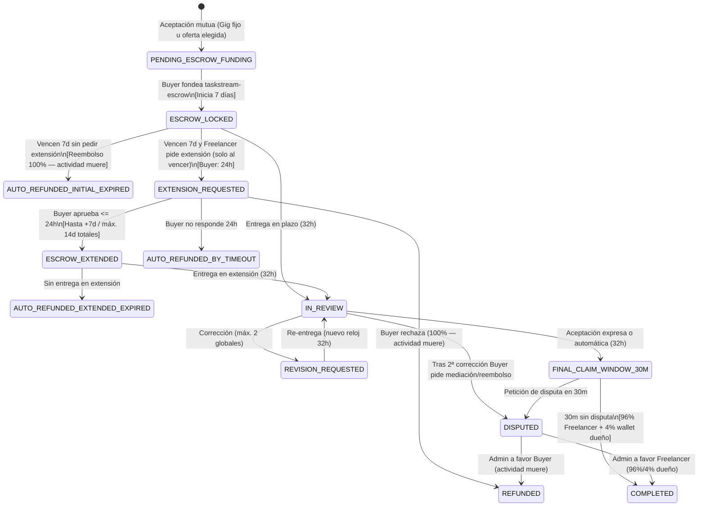
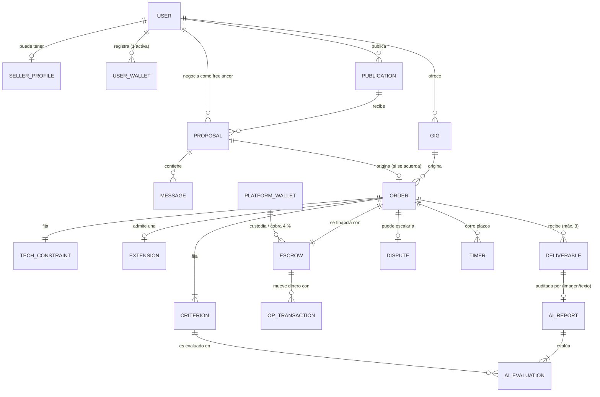
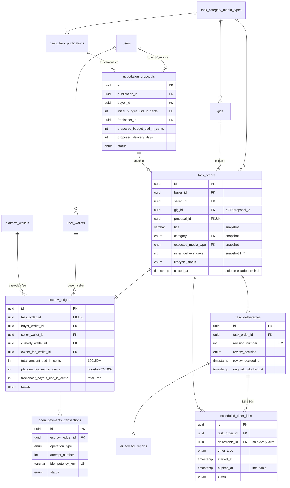

# Arquitectura General del Sistema, Flujo de Pagos y Modelo de Datos — TaskStream AI (`architecture-overview.md`)

> **Documento Oficial de Arquitectura (`architecture-overview.md`):** Define la arquitectura técnica integral de **TaskStream AI**, la estructura del proyecto, el **flujo completo de contratación, escrow, entregas, revisiones, extensiones, reclamaciones y pagos**, el contrato exacto del servicio de IA (**acotado en el MVP exclusivamente a tareas de imagen y texto**) y el **Modelo de Datos Relacional v2 en PostgreSQL + Prisma 6**, documentado en sus tres pasos (conceptual, lógico y físico), normalizado hasta FNBC con desnormalizaciones justificadas y con `TaskOrder` desacoplada en contextos delimitados.
>
> 🔗 **Alineado con:** `CONTEXT.md`, `AGENTS.md`, `AI_USAGE.md`, `taskboard.md`, `pbp-development.md` y `sdd-process.md`.

---

## 1. Objetivo, Participantes y Visión Arquitectónica

**TaskStream AI** es un marketplace de tareas y servicios digitales para todo el continente americano que conecta a cuatro actores clave sobre el estándar abierto **Open Payments API v7.4.0** e **Interledger Protocol (ILP)**:

* **Buyer (Contratante):** Publica o contrata un trabajo, negocia el presupuesto (siempre menor o igual al presupuesto inicial planteado) y deposita el 100 % de los fondos de la orden.
* **Freelancer (Trabajador Independiente):** Realiza y entrega el trabajo contratado conforme a los requisitos y el alcance acordados.
* **TaskStream AI (Plataforma y Custodia en Escrow):** Facilita la contratación, custodia fondos en `taskstream-escrow`, ejecuta relojes deterministas, *Protected Preview*, IA consultiva (imagen/texto en MVP), reembolsos **100 %** y liberación **96 % Freelancer / 4 % wallet del dueño** (billetera distinta del escrow).
* **Administrador:** Interviene cuando el Buyer pide **mediación/reembolso** tras la 2ª corrección o registra una **petición de disputa** en la ventana de 30 minutos; decide de forma binaria y justificada.

---

## 2. Flujo Completo de Contratación, Escrow, Entregas, Revisiones y Pagos

El dinero de toda orden se mantiene asegurado en el escrow de TaskStream hasta que se cumplan las condiciones deterministas para liberarlo o reembolsarlo.

### 2.1. Tabla Maestra de Plazos y Reglas Operativas

Los plazos del sistema son **independientes entre sí** y son gobernados en el Backend mediante colas deterministas en **BullMQ + Redis**:

| Situación / Reloj Determinista | Plazo | Regla de Negocio Inmutable |
| :--- | ---: | :--- |
| **Entrega inicial (`INITIAL_DELIVERY_7D`)** | **7 días** | Si vence **sin** petición de extensión → **reembolso automático 100 %** (`AUTO_REFUNDED_INITIAL_EXPIRED`); la actividad **muere**. |
| **Respuesta a solicitud de extensión (`EXTENSION_RESPONSE_24H`)** | **24 horas** | Solo si el Freelancer pidió extensión **al vencer** los 7 días (no antes). Silencio del Buyer → reembolso **100 %**. |
| **Extensión (`EXTENDED_DELIVERY_UP_TO_7D`)** | **Hasta +7 días** | **Una** vez por orden; **solo al vencer** el plazo inicial (máx. 14 días totales). Sin entrega → reembolso **100 %**. |
| **Revisión (`DELIVERY_REVIEW_32H`)** | **32 horas** | Aceptar, pedir corrección (máx. 2 globales) o timeout = aceptación automática → ventana 30 m. |
| **Ventana final (`FINAL_CLAIM_WINDOW_30M`)** | **30 minutos** | Sin petición de disputa → **96 % Freelancer + 4 % wallet dueño**. Con petición → `DISPUTED`. |
| **Correcciones (`maxRevisions = 2`)** | **Máx. 2 globales** | Tras la **2ª** re-entrega: Buyer **acepta** o **pide mediación** (Admin). No se reinicia con extensión. |

---

### 2.2. Detalle Arquitectónico del Ciclo de Vida Financiero y de Ejecución

#### A. Modalidades de Contratación e Inicio (Escrow solo tras Aceptación Mutua)

1. **Gig (precio fijo, no negociable):** El Freelancer publica un paquete a precio cerrado; el Buyer contrata ese monto sin contraoferta.
2. **Publicación del Buyer (tope + bandeja de ofertas):** El Buyer publica con presupuesto máximo; varios freelancers ofertan `<= tope`; el Buyer ve ofertas/perfiles y **elige una**. Puede **cancelar** la publicación antes de aceptar.
3. **Arranque:** El flujo financiero **no comienza** hasta que **ambas partes aceptan** la actividad y el Buyer deposita el **100 %** en `taskstream-escrow` (`receiveAmount = 100% USD`, Buyer asume FX). Entonces `ESCROW_LOCKED` + reloj de **7 días**.

#### B. Si el Freelancer Entrega a Tiempo (Dentro de los Primeros 7 Días o de la Extensión Aprobada)
Cuando el Freelancer sube la entrega a Cloudflare R2 (`/originals`), el sistema genera el *Protected Preview* con marca de agua (`/previews`), ejecuta la auditoría consultiva de IA (si la tarea corresponde a **imagen o texto**) e inicia el **periodo de revisión de 32 horas** del Buyer (`IN_REVIEW`). Durante esas **32 horas**, el Buyer tiene tres caminos:

1. **Aceptar expresamente:** No libera al instante → ventana **30 min**. Sin petición de disputa → **96 % Freelancer + 4 % wallet dueño** (`COMPLETED`).
2. **Timeout 32h:** Aceptación automática → misma ventana de **30 min**.
3. **Correcciones (máx. 2):** Cada re-entrega reinicia 32h. Tras la **2ª** re-entrega el Buyer puede **aceptar** (→ 30 min) o **pedir mediación/reembolso** (`DISPUTED`).

#### C. Disputa Administrativa (Petición Explícita)
Se abre `DISPUTED` cuando el Buyer **pide mediación** tras la 2ª corrección o registra **petición de disputa** en los 30 min. Fondos retenidos sin automatismos. Admin decide con justificación: **100 % Buyer** (`REFUNDED`, actividad muere, Freelancer desligado) o **96 % / 4 % wallet dueño** (`COMPLETED`).

#### D. Sin Entrega en 7 Días (Extensión Solo al Vencer)
1. **Sin petición de extensión al vencer** → `AUTO_REFUNDED_INITIAL_EXPIRED` (actividad muere).
2. **Con petición al vencer** (`EXTENSION_REQUESTED`): Buyer tiene **24h**.
3. Aprueba → `ESCROW_EXTENDED` (hasta +7d; no reinicia correcciones).
4. Rechaza → `REFUNDED` (actividad muere).
5. No responde → `AUTO_REFUNDED_BY_TIMEOUT`.
6. Aprobó pero no entrega en extensión → `AUTO_REFUNDED_EXTENDED_EXPIRED`.
7. **Todo reembolso termina la actividad**; el Buyer busca otra persona en un ciclo nuevo (no hay `REFUNDED_AND_REOPENED`).

#### E. Ventana Final de 30 Minutos
Si hay **petición de disputa** en los 30 min → cancelación atómica del job BullMQ → `DISPUTED`. Si no hay petición → liberación **96 % / 4 % wallet dueño**.

---

### 2.3. Diagrama de Máquina de Estados del Flujo Completo



---

## 3. Alcance del Motor de IA (`AiAdvisorService`) en el MVP y Contrato Exacto

### 3.1. Alcance Estricto en el MVP: Auditoría y Asesoría Exclusiva para Imagen y Texto

De conformidad con la definición de alcance en `CONTEXT.md`:

1. **En el MVP, `AiAdvisorService` únicamente audita y asesora tareas cuyos entregables sean de IMAGEN o TEXTO (`IMAGE_RASTER_VECTOR` y `DOCUMENT_TEXT`):**
   * **Entregables de Texto (`.txt`, `.md`, `.pdf`, `.docx`):** Evaluación semántica de cumplimiento de criterios de aceptación, conteo de palabras, estructura e integridad frente a los requisitos de la orden.
   * **Entregables de Imagen (`.png`, `.jpg`, `.webp`, `.svg`):** Evaluación multimodal visual y de dimensiones/formato frente a los criterios de aceptación acordados.
2. **Resto de Formatos y Modelo de Suscripción (Planteados para Post-MVP):**
   * La auditoría de IA para el resto de los tipos de archivo (video, audio, paquetes complejos de código o datasets masivos) y la idea de una suscripción para compradores (`Buyer AI Pro Subscription`) **quedan únicamente planteadas como visión futura y no entran dentro de la implementación del MVP**. En el MVP, dichas categorías operan normalmente con almacenamiento en R2, *Protected Preview* y los plazos de 32 horas / 30 minutos sin invocar auditoría de IA.

### 3.2. Contrato Exacto de Entrada (`AiAdvisorInputContractSchema`) para Generar `AiAdvisorReportSchema`

Para construir `AiAdvisorReportSchema` con total precisión (especificado en `SPEC-08.md`), el servicio `AiAdvisorService` recibe un **Contrato de Entrada Estrictamente Tipado (`AiAdvisorInputContractSchema`)** que le proporciona todo el contexto determinista de la orden antes de invocar al modelo:

```typescript
import { z } from 'zod';

/**
 * MODALIDADES AUDITABLES POR IA EN EL MVP (Exclusivamente Imagen y Texto)
 */
export const MvpAiAuditableModalityEnum = z.enum([
  'IMAGE', // .png, .jpg, .webp, .svg
  'TEXT',  // .txt, .md, .pdf, .docx
]);

/**
 * CONTRATO EXACTO DE ENTRADA QUE RECIBE AiAdvisorService (Definido para SPEC-08)
 */
export const AiAdvisorInputContractSchema = z.object({
  taskOrderId: z.string().uuid(),
  deliverableId: z.string().uuid(),
  revisionNumber: z.number().int().min(0).max(2)
    .describe('0 = Entrega inicial, 1 = Corrección 1, 2 = Corrección 2'),
  category: z.enum([
    'DIGITAL_MARKETING',
    'GRAPHICS_AND_DESIGN',
    'PROGRAMMING_AND_TECH',
    'TECHNICAL_WRITING_TRANS',
    'VIDEO_AND_ANIMATION',
    'MUSIC_AND_AUDIO',
  ]),
  auditableModality: MvpAiAuditableModalityEnum
    .describe('En el MVP solo se auditan entregas de tipo IMAGE o TEXT'),
  orderContext: z.object({
    title: z.string(),
    scopeDescription: z.string(),
    acceptanceCriteria: z.array(
      z.object({
        criterionId: z.string(),
        description: z.string(),
        isMandatory: z.boolean(),
      })
    ).min(1),
    previousRevisionNotes: z.array(z.string()).optional()
      .describe('Solicitudes de corrección previas del Buyer si revisionNumber > 0'),
  }),
  deliverableArtifact: z.object({
    fileName: z.string(),
    mimeType: z.string(),
    fileExtension: z.string(),
    fileSizeBytes: z.number().int().positive(),
    sha256Checksum: z.string().length(64),
    // Datos extraídos para evaluación determinista y consultiva (Imagen o Texto)
    extractedTextContent: z.string().optional()
      .describe('Texto plano extraído y encapsulado en <untrusted_deliverable_artifact> cuando auditableModality == TEXT'),
    wordCount: z.number().int().nonnegative().optional(),
    imageSignedUrlOrBase64: z.string().optional()
      .describe('Imagen para análisis multimodal cuando auditableModality == IMAGE'),
    imageDimensions: z.object({
      widthPx: z.number().int().positive(),
      heightPx: z.number().int().positive(),
    }).optional(),
  }),
  deterministicPreCheckResult: z.object({
    extensionAllowed: z.boolean(),
    nonEmptyFile: z.boolean(),
    technicalConstraintsMet: z.boolean(),
    failureReasons: z.array(z.string()),
  }),
});
```

A partir de este `AiAdvisorInputContractSchema`, el servicio `AiAdvisorService` produce como salida el `AiAdvisorReportSchema` (puntaje orientativo `0–100`, evaluación individual de cada `criterionId`, resumen ejecutivo para el Buyer, sugerencias para el Freelancer en caso de pedir una de sus 2 correcciones y descargo de responsabilidad confirmando que la IA nunca libera ni bloquea pagos).

---

## 4. Estructura del Proyecto (Monorepo Turborepo)

El repositorio está estructurado para que los **5 desarrolladores (`2 Frontend: FE-1, FE-2 / 2 Backend: BE-1, BE-2 / 1 IA: AI-1`)** trabajen de forma modular y sin bloqueos:

```text
Haki-Suave/ (TaskStream AI)
├── .agents/
│   ├── CONTEXT.md                             # Única Fuente de Verdad (SSoT)
│   └── skills/                                # Herramientas de apoyo al diseño
├── specs/                                     # Carpeta de especificaciones (Creada en SPEC-00)
│   ├── README.md                              # Índice y guía de especificaciones
│   ├── SPEC-00.md                             # Creación de estructura specs y README
│   ├── SPEC-01.md ... SPEC-11.md              # Especificaciones de módulos del MVP
│   └── SPEC-12.md                             # Especificación final de Deploy
├── prompts/
│   └── AI_USAGE.md                            # Registro íntegro de prompts (Política Hackathon)
├── packages/
│   └── shared-schemas/                        # Contratos Zod compartidos (Orden, Pagos, Plazos, IA)
├── apps/
│   ├── web/                                   # Next.js 15.5 + React 19 (FE-1: UI/Flujos | FE-2: 3D ScrollTrigger & Previews)
│   └── api/                                   # NestJS 10.4 + Prisma 6 + BullMQ (BE-1: Open Payments Manual | BE-2: R2 & Timers | AI-1: AiAdvisorService)
├── AGENTS.md                                  # Reglas globales de gobernanza
├── AI_USAGE.md                                # Registro auditable de uso de IA
├── promptsAI_USAGE.md                         # Bitácora íntegra de prompts en raíz
├── architecture-overview.md                   # Arquitectura general y modelo de datos
├── taskboard.md                               # Tablero de tareas, prioridades y decisiones
├── pbp-development.md                         # Desarrollo fase por fase por roles
└── sdd-process.md                             # Proceso general SDD del proyecto
```

---

## 5. Modelado de la Base de Datos (PostgreSQL + Prisma 6) — Modelo v2 Desacoplado

El modelo se documenta en los tres pasos clásicos, cada uno con su propio nivel de abstracción: **conceptual** (qué existe en el negocio), **lógico** (relaciones, claves, dependencias y normalización) y **físico** (cómo se materializa en PostgreSQL). La versión v2 resuelve la auditoría del modelo v1, en la que `TaskOrder` concentraba 31 atributos, 14 FK y cuatro dominios.

**Fuentes canónicas.** Este documento explica el modelo pero no copia el esquema completo, para no crear una segunda fuente de verdad:

| Artefacto | Contenido |
| :--- | :--- |
| [`apps/api/prisma/schema.prisma`](../apps/api/prisma/schema.prisma) | Tablas, columnas, FK, índices simples y compuestos. |
| [`apps/api/prisma/sql/domain_checks.sql`](../apps/api/prisma/sql/domain_checks.sql) | Lo que Prisma 6 no modela: `CHECK`, índices parciales, triggers, vistas y datos de referencia. |
| [`apps/api/prisma/migrations/20261017000000_decouple_task_order/`](../apps/api/prisma/migrations/20261017000000_decouple_task_order/migration.sql) | Migración v1 → v2: DDL generado por Prisma más la capa física canónica. |

---

### 5.1. Paso 1 — Modelo Conceptual

#### 5.1.1. Contextos Delimitados (*Bounded Contexts*)

Cada contexto es dueño de sus datos. Las dependencias van en un solo sentido: **Identidad ← Marketplace ← Contratación ← Finanzas / Ejecución**. Ningún contexto aguas arriba conoce a uno aguas abajo (una publicación no sabe qué orden nació de ella; la orden sí sabe su origen).

| Contexto | Entidades | Responsabilidad | Responsable |
| :--- | :--- | :--- | :--- |
| **Identidad** | `User`, `SellerProfile`, `UserWallet`, `WalletVerificationChallenge`, `PlatformWallet` | Quién es cada actor y a qué wallets se le puede pagar. | BE-1 |
| **Marketplace** | `TaskCategoryMediaType`, `Gig`, `ClientTaskPublication`, `NegotiationProposal`, `NegotiationMessage` | Oferta y demanda antes del contrato; negociación siempre a la baja. | FE-1 / BE-1 |
| **Contratación** | `TaskOrder`, `TaskAcceptanceCriterion`, `TaskTechnicalConstraint`, `DeadlineExtensionRequest` | El contrato: partes, términos congelados y la extensión única. | BE-1 |
| **Finanzas** | `EscrowLedger`, `OpenPaymentsTransaction`, `RafikiWebhookEvent` | Custodia del 100 %, reparto 96/4 y reembolso 100 %. | BE-2 |
| **Ejecución** | `TaskDeliverable`, `AiAdvisorReport`, `AiCriterionEvaluation`, `DisputeCase`, `ScheduledTimerJob` | Entregas, revisión, IA consultiva, mediación y relojes. | BE-2 / AI-1 |

#### 5.1.2. Diagrama Conceptual (entidades de negocio, sin atributos)



#### 5.1.3. Reglas de Negocio que el Modelo Debe Garantizar

| ID | Regla | Dónde se garantiza |
| :--- | :--- | :--- |
| R-01 | Un usuario tiene como máximo una wallet activa, y solo si está verificada. | Índice parcial + `CHECK` |
| R-02 | La negociación es siempre a la baja y nadie negocia consigo mismo. | `CHECK` |
| R-03 | Una publicación termina en un único acuerdo. | Índice parcial (SEC-GAP-01) |
| R-04 | Una orden nace de exactamente un origen: Gig o propuesta acordada. | `CHECK` + trigger |
| R-05 | Los términos acordados no cambian después del contrato. | Columnas snapshot + trigger |
| R-06 | Montos en centavos USD entre 100 y 50.000.000; reparto `floor(total*4/100)` / resto. | `CHECK` + `money.ts` |
| R-07 | El 96 % va a la wallet del Freelancer vigente al contratar; el 4 % a la wallet del dueño, distinta del escrow. | FK a filas inmutables + trigger |
| R-08 | Plazos: 1–7 días iniciales, 24 h de respuesta, +1–7 días, 32 h de revisión, 30 min de ventana final. | `CHECK` por tipo de reloj + trigger |
| R-09 | Máximo 2 correcciones globales; la revisión *n* exige que la *n-1* haya sido devuelta. | `CHECK` + trigger |
| R-10 | La IA solo audita entregas de imagen o texto, y nunca decide pagos. | Trigger + contrato Zod |
| R-11 | Una disputa resuelta exige administrador y justificación de al menos 20 caracteres. | `CHECK` |
| R-12 | No se borran contratos ni dinero: el historial financiero es inmutable. | `ON DELETE RESTRICT` |

---

### 5.2. Paso 2 — Modelo Lógico

#### 5.2.1. Esquema Relacional

Notación: **PK** clave primaria, **FK** clave foránea, **AK** clave candidata alterna (`UNIQUE`), *AK parcial* = única solo bajo una condición.

| Relación | PK | FK | AK |
| :--- | :--- | :--- | :--- |
| `users` | `id` | — | `clerk_id`; `email` |
| `seller_profiles` | `id` | `user_id → users` | `user_id` |
| `user_wallets` | `id` | `user_id → users` | `wallet_address_url`; *parcial* `user_id WHERE is_active` |
| `wallet_verification_challenges` | `id` | `wallet_id → user_wallets` | `client_nonce` |
| `platform_wallets` | `id` | — | `wallet_address_url`; *parcial* `role WHERE is_active` |
| `task_category_media_types` | `(category, media_type)` | — | — |
| `gigs` | `id` | `seller_id → users`; `(category, expected_media_type) → task_category_media_types` | — |
| `client_task_publications` | `id` | `buyer_id → users`; `(category, expected_media_type) → task_category_media_types` | `(id, buyer_id, initial_budget_usd_in_cents)` (destino de FK compuesta) |
| `negotiation_proposals` | `id` | `(publication_id, buyer_id, initial_budget_usd_in_cents) → client_task_publications`; `buyer_id → users`; `freelancer_id → users` | *parcial* `publication_id WHERE AGREED_PATH_1`; *parcial* `(publication_id, freelancer_id) WHERE IN_NEGOTIATION` |
| `negotiation_messages` | `id` | `proposal_id → negotiation_proposals`; `sender_id → users` | — |
| `task_orders` | `id` | `buyer_id`, `seller_id → users`; `gig_id → gigs`; `proposal_id → negotiation_proposals`; `(category, expected_media_type) → task_category_media_types` | `proposal_id` |
| `task_acceptance_criteria` | `id` | `task_order_id → task_orders` | `(task_order_id, criterion_code)` |
| `task_technical_constraints` | `task_order_id` | `task_order_id → task_orders` | — |
| `deadline_extension_requests` | `id` | `task_order_id → task_orders` | `task_order_id` |
| `escrow_ledgers` | `id` | `task_order_id → task_orders`; `buyer_wallet_id`, `seller_wallet_id → user_wallets`; `custody_wallet_id`, `owner_fee_wallet_id → platform_wallets` | `task_order_id` |
| `open_payments_transactions` | `id` | `escrow_ledger_id → escrow_ledgers` | `idempotency_key`; `(escrow_ledger_id, operation_type, attempt_number)`; *parciales* por pierna |
| `rafiki_webhook_events` | `id` | — | `event_id` |
| `task_deliverables` | `id` | `task_order_id → task_orders` | `(task_order_id, revision_number)`; `original_r2_key`; `preview_r2_key`; *parcial* `task_order_id WHERE PENDING_REVIEW` |
| `ai_advisor_reports` | `id` | `deliverable_id → task_deliverables` | `deliverable_id` |
| `ai_criterion_evaluations` | `id` | `ai_report_id → ai_advisor_reports`; `criterion_id → task_acceptance_criteria` | `(ai_report_id, criterion_id)` |
| `dispute_cases` | `id` | `task_order_id → task_orders`; `admin_reviewer_id → users` | `task_order_id` |
| `scheduled_timer_jobs` | `id` | `task_order_id → task_orders`; `deliverable_id → task_deliverables` | `bullmq_job_id`; *parcial* `task_order_id WHERE SCHEDULED` |

`id` es un UUID subrogado en todas las entidades. Cuando existe una clave natural estable se declara como AK (`clerk_id`, `wallet_address_url`, `idempotency_key`, `(task_order_id, revision_number)`).

#### 5.2.2. Diagrama Lógico (claves y atributos determinantes)



#### 5.2.3. Normalización

**1FN.** Todos los atributos son atómicos respecto a cómo se consultan. Hay dos excepciones deliberadas:

* `allowed_extensions`, `skills`, `languages` y `suggestions_for_freelancer` son `text[]`. Se leen y escriben siempre como un todo, nunca se buscan elemento a elemento ni se referencian desde otra tabla. Son valores compuestos del dominio, no grupos repetidos.
* `default_criteria_json` y `preliminary_criteria_json` (JSONB, validados por Zod) son **plantillas** editables del Gig o de la publicación. Al nacer la orden se copian fila a fila a `task_acceptance_criteria`, que sí está normalizada y es la que referencian las evaluaciones de IA.

**2FN.** Todas las tablas con PK simple cumplen trivialmente. En las de PK compuesta (`task_category_media_types`) no hay atributos no clave. Las AK compuestas (`(task_order_id, revision_number)`, `(ai_report_id, criterion_id)`) no tienen atributos que dependan solo de una parte.

**3FN / FNBC.** Dependencias funcionales principales después del desacople:

| Relación | Dependencias funcionales | Resultado |
| :--- | :--- | :--- |
| `task_orders` | `id → buyer_id, seller_id, gig_id, proposal_id, términos, lifecycle_status, closed_at`; `proposal_id → id` | FNBC: todo determinante es clave candidata. |
| `escrow_ledgers` | `id → todo`; `task_order_id → id`; `total → platform_fee, freelancer_payout` | `total → fee` es una dependencia transitiva **aceptada y controlada** (ver abajo). |
| `negotiation_proposals` | `id → todo`; `publication_id → buyer_id, initial_budget` | Redundancia **controlada**: la FK compuesta impide divergencia. |
| `task_deliverables` | `id → todo`; `(task_order_id, revision_number) → id` | FNBC. |
| `ai_advisor_reports` | `id → todo`; `deliverable_id → id` | FNBC (en v1, `task_order_id` y `revision_evaluated` eran transitivos vía `deliverable_id`; eliminados). |
| `scheduled_timer_jobs` | `id → todo` | FNBC. La duración es función del tipo y se impone por `CHECK`, sin columna redundante. |

**Desnormalizaciones conservadas y por qué no rompen la integridad:**

| Dato | Por qué se conserva | Cómo se evita la divergencia |
| :--- | :--- | :--- |
| `escrow_ledgers.platform_fee` y `freelancer_payout` | Son las cifras exactas instruidas a Open Payments y auditadas por la conciliación. | `chk_escrow_exact_96_4_split` las recalcula en cada escritura. |
| `negotiation_proposals.buyer_id` e `initial_budget` | El `CHECK` de oferta a la baja y el anti *self-dealing* son por fila. | FK compuesta a `(id, buyer_id, initial_budget)` de la publicación con `ON UPDATE CASCADE`. |
| `task_orders.title`, `scope_description`, `category`, `expected_media_type`, `initial_delivery_days` | Son la **foto del contrato**: el Gig puede editarse después sin alterar órdenes vivas. No es redundancia, es otro hecho (lo acordado en una fecha). | Trigger `fn_task_order_origin_guard` valida contra el origen al insertar y prohíbe cambiarlos después. |
| `task_orders.buyer_id` y `seller_id` | Son las partes del contrato y se consultan en cada listado. Derivarlos del origen costaría dos rutas de join distintas (Gig o propuesta). | El mismo trigger exige que coincidan con el origen. |

**Valores derivados que ya no se almacenan** (se leen de vistas):

| Antes (v1) | Ahora (v2) |
| :--- | :--- |
| `task_orders.revisions_used` | `v_task_order_revision_usage` = `count(review_decision = 'REVISION_REQUESTED')` |
| Plazos copiados en `task_orders` y `task_deliverables` | `v_task_order_active_deadline` (el reloj `SCHEDULED`) |
| `escrow_ledgers.released_to_seller…`, `refunded_to_buyer…`, `platform_fee_paid_out…` | `v_escrow_ledger_settlement` (pierna completada según las transacciones) |
| `seller_profiles.completed_orders_count`, `ai_advisory_score_avg`, `rating_avg` | `v_seller_profile_stats` (`rating_avg` se eliminó: no existe flujo de calificación en el MVP) |
| `task_orders.ai_auditable_modality`, `ai_advisor_reports.auditable_modality` | `resolveMvpAiAuditableModality(expected_media_type)` |
| `ai_advisor_reports.mandatory_disclaimer` | Constante `MANDATORY_AI_DISCLAIMER` del contrato Zod |

#### 5.2.4. Resolución de la Auditoría

| # | Hallazgo de la auditoría | Modelo v1 | Modelo v2 |
| :-- | :--- | :--- | :--- |
| A-1 | Los tres pasos de modelado estaban mezclados. | Una sola sección con lista de verificación, diagrama y schema. | §5.1 conceptual, §5.2 lógico, §5.3 físico. |
| A-2 | `TaskOrder` era una *God Entity* latente (31 atributos, 14 FK, 4 dominios). | Dinero, wallets, contadores, relojes y modalidad IA en la orden. | 14 columnas: partes, origen, términos congelados y estado. Dinero y wallets en `EscrowLedger`, plazos en `ScheduledTimerJob`, correcciones en `TaskDeliverable`. |
| A-3 | Origen redundante `publicationId + proposalId + gigId`. | Tres FK y un `CHECK` de dos ramas. | `gig_id` XOR `proposal_id` (`num_nonnulls = 1`); la publicación se alcanza por la propuesta. |
| A-4 | `AiAdvisorReport.taskOrderId` duplicaba el camino vía la entrega. | FK directa a la orden más `revision_evaluated`. | La IA cuelga solo de la entrega; orden y revisión se derivan. |
| A-5 | `OpenPaymentsTransaction` tenía `taskOrderId` y `escrowLedgerId`. | Dos caminos que podían divergir. | Solo `escrow_ledger_id`. |
| A-6 | Wallets en `TaskOrder`. | `buyer_wallet_id`, `seller_wallet_id` en la orden y direcciones de plataforma como texto en el ledger. | Las cuatro wallets son FK de `EscrowLedger`; las de plataforma están normalizadas en `platform_wallets`. |
| A-7 | El plazo de 32 h vivía en tres lugares (*split-brain*). | `task_orders.current_review_*`, `task_deliverables.review_*` y el timer. | Solo `scheduled_timer_jobs.expires_at`, inmutable y con duración fijada por `CHECK`. |
| A-8 | El redondeo 96/4 no tenía fórmula canónica. | El `CHECK` aceptaba cualquier reparto que sumara el total. | `fee = floor(total*4/100)` idéntico en SQL (`::bigint`) y en `money.ts`. |
| A-9 | Faltaba el índice parcial de wallet activa única. | Solo un índice compuesto no único. | `user_wallets_one_active_per_user` + `chk_wallet_active_requires_verified`. |
| A-10 | Múltiples rutas de borrado en cascada. | `TaskOrder` y sus hijos en `Cascade`, alcanzables por varios caminos. | Contratos, dinero, entregas y relojes en `Restrict`. `Cascade` solo para datos que pertenecen a su padre (perfil, desafíos de wallet, mensajes, evaluaciones IA). |

#### 5.2.5. Hallazgos Propios Adicionales

| # | Hallazgo | Corrección v2 |
| :-- | :--- | :--- |
| P-1 | Dos propuestas podían quedar `AGREED_PATH_1` sobre la misma publicación (SEC-GAP-01). | Índice parcial `negotiation_proposals_one_agreement_per_publication`. |
| P-2 | `category` y `expected_media_type` podían contradecirse (p. ej. diseño con audio). | Tabla de referencia `task_category_media_types` con FK compuesta en Gig, publicación y orden. |
| P-3 | Self-dealing: un usuario podía ser buyer y seller de su propia orden o negociación. | `chk_task_order_no_self_dealing`, `chk_proposal_no_self_dealing`, `chk_escrow_distinct_party_wallets`. |
| P-4 | La propuesta no guardaba el plazo negociado, así que la orden no tenía de dónde copiarlo. | `proposed_delivery_days` en la propuesta y `offered_delivery_days` en los mensajes. |
| P-5 | La propuesta replicaba `buyer_id` e `initial_budget` sin garantía de coincidir con la publicación. | FK compuesta hacia la publicación. |
| P-6 | La wallet del Freelancer se leía de su perfil al pagar; si la cambiaba, el 96 % iba a otra dirección (SEC-GAP-04). | El ledger referencia filas de wallet inmutables, validadas por trigger al crearse. |
| P-7 | Un reintento de liquidación podía duplicar la pierna del 96 % o la del 4 % (SEC-GAP-06). | `(ledger, operación, intento)` único; como máximo un intento `COMPLETED` y uno en curso por pierna. |
| P-8 | `is_original_unlocked` y `unlocked_at` podían contradecirse; el original podía desbloquearse sin aceptación. | Solo `original_unlocked_at`, permitido únicamente tras aceptación o mediación. |
| P-9 | Se podía entregar la revisión 2 sin que la 1 hubiera sido devuelta, o tener dos entregas en revisión. | Trigger de secuencia + índice parcial de una revisión pendiente por orden. |
| P-10 | `closed_at`, `completed_at`, `refunded_at` en la orden podían contradecir el estado. | Un único `closed_at` presente si y solo si el estado es terminal. |
| P-11 | Montos sin tope: un `int4` de centavos podía desbordar al multiplicar por 4. | Rango `[100, 50.000.000]` y cálculo en `bigint`. |
| P-12 | `max_revisions_allowed`, `review_window_hours` y `final_claim_window_minutes` eran columnas que el `CHECK` obligaba a ser constantes. | Eliminadas: son reglas del dominio en el código y en el `CHECK` de cada reloj. |
| P-13 | `requested_by_id` y `opened_by_id` repetían a una de las partes de la orden. | Eliminados: la extensión la pide siempre el seller y la disputa la abre siempre el buyer. |
| P-14 | Un reporte IA podía evaluar criterios de otra orden, o existir para una orden de video. | Triggers `fn_ai_criterion_same_order` y `fn_ai_report_mvp_modality`. |

---

### 5.3. Paso 3 — Modelo Físico

#### 5.3.1. Convenciones

| Aspecto | Decisión |
| :--- | :--- |
| Motor | PostgreSQL ≥ 14 (Supabase), Prisma 6.19 con `prisma-client-js`, `url` (pooler) y `directUrl` (migraciones). |
| Nombres | Modelos en PascalCase y campos en camelCase en Prisma; tablas y columnas en `snake_case` vía `@@map` / `@map`. |
| Identificadores | `uuid` generado por Prisma (`@default(uuid())`), tipo `@db.Uuid`. |
| Dinero | `integer` en centavos USD. Nunca `float` ni `decimal`. Multiplicaciones en `bigint`. |
| Tiempo | `timestamp(3)` en UTC. Todo plazo es `started_at` + `expires_at` en su reloj. |
| Estados | Enums de PostgreSQL espejo de los enums Zod de `@taskstream/shared-schemas`. |
| Errores de dominio | Los triggers lanzan `check_violation` con un código legible (`TASK_ORDER_ORIGIN_MISMATCH`, `ESCROW_TOTAL_MISMATCH`, …). |

#### 5.3.2. Extractos Clave de `schema.prisma`

```prisma
/// Contrato entre Buyer y Freelancer. No guarda dinero, wallets, contadores ni relojes.
model TaskOrder {
  id                  String               @id @default(uuid()) @db.Uuid
  buyerId             String               @map("buyer_id") @db.Uuid
  sellerId            String               @map("seller_id") @db.Uuid
  gigId               String?              @map("gig_id") @db.Uuid
  proposalId          String?              @unique @map("proposal_id") @db.Uuid
  title               String               @db.VarChar(120)
  scopeDescription    String               @map("scope_description") @db.Text
  category            TaskCategory
  expectedMediaType   DeliverableMediaType @map("expected_media_type")
  initialDeliveryDays Int                  @map("initial_delivery_days")
  lifecycleStatus     TaskLifecycleStatus  @default(PENDING_ESCROW_FUNDING) @map("lifecycle_status")
  createdAt           DateTime             @default(now()) @map("created_at")
  updatedAt           DateTime             @updatedAt @map("updated_at")
  closedAt            DateTime?            @map("closed_at")
  // relaciones: buyer, seller, gig?, proposal?, categoryMedia, criterios,
  // restricción técnica, extensión?, escrowLedger?, entregas, disputa?, relojes
}

model EscrowLedger {
  id                         String             @id @default(uuid()) @db.Uuid
  taskOrderId                String             @unique @map("task_order_id") @db.Uuid
  buyerWalletId              String             @map("buyer_wallet_id") @db.Uuid
  sellerWalletId             String             @map("seller_wallet_id") @db.Uuid
  custodyWalletId            String             @map("custody_wallet_id") @db.Uuid
  ownerFeeWalletId           String             @map("owner_fee_wallet_id") @db.Uuid
  totalAmountUSDInCents      Int                @map("total_amount_usd_in_cents")
  platformFeeUSDInCents      Int                @map("platform_fee_usd_in_cents")
  freelancerPayoutUSDInCents Int                @map("freelancer_payout_usd_in_cents")
  status                     EscrowLedgerStatus @default(AWAITING_FUNDS)
  fundsLockedAt              DateTime?          @map("funds_locked_at")
  settledAt                  DateTime?          @map("settled_at")
  // ...
}

/// Única fuente de verdad de todos los plazos. `expiresAt` es inmutable.
model ScheduledTimerJob {
  id            String         @id @default(uuid()) @db.Uuid
  taskOrderId   String         @map("task_order_id") @db.Uuid
  deliverableId String?        @map("deliverable_id") @db.Uuid
  timerType     TimerJobType   @map("timer_type")
  bullmqJobId   String         @unique @map("bullmq_job_id")
  startedAt     DateTime       @map("started_at")
  expiresAt     DateTime       @map("expires_at")
  status        TimerJobStatus @default(SCHEDULED)
  // ...
}
```

#### 5.3.3. Fórmula Canónica del Reparto 96/4

En centavos enteros, idéntica en TypeScript (`splitSingleBlockEscrow` en `packages/shared-schemas/src/money.ts`) y en SQL (`chk_escrow_exact_96_4_split`):

```text
platform_fee      = floor(total * 4 / 100)     -- SQL: total::bigint * 4 / 100
freelancer_payout = total - platform_fee
total ∈ [100, 50_000_000]
```

| Total (centavos) | Fee 4 % | Payout 96 % | Nota |
| --: | --: | --: | :--- |
| 100 | 4 | 96 | Mínimo permitido. |
| 10.000 | 400 | 9.600 | Exacto. |
| 10.001 | 400 | 9.601 | El centavo residual va al Freelancer. |
| 12.345 | 493 | 11.852 | `floor(493,8)`; no se redondea hacia arriba. |
| 50.000.000 | 2.000.000 | 48.000.000 | Máximo permitido. |

#### 5.3.4. Catálogo de Restricciones `CHECK`

| Tabla | Restricción | Regla |
| :--- | :--- | :--- |
| `user_wallets` | `chk_wallet_active_requires_verified`, `chk_wallet_verified_at_coherent`, `chk_wallet_asset_scale` | Activa ⇒ verificada; `verified_at` coherente; escala 0–18. |
| `platform_wallets` | `chk_platform_wallet_asset_scale` | Escala 0–18. |
| `gigs` | `chk_gig_price_and_days` | Precio en rango, días 1–7, al menos una extensión. |
| `client_task_publications` | `chk_publication_budget_and_days` | Presupuesto en rango, días 1–7, `republish_count ≥ 0`. |
| `negotiation_proposals` | `chk_proposal_downward_only`, `chk_proposal_no_self_dealing`, `chk_proposal_closed_at_coherent` | 100 ≤ propuesto ≤ inicial, días 1–7; freelancer ≠ buyer; `closed_at` si y solo si cerrada. |
| `negotiation_messages` | `chk_message_offer_range` | Contraofertas en rango. |
| `task_orders` | `chk_task_order_single_origin`, `chk_task_order_no_self_dealing`, `chk_task_order_initial_days`, `chk_task_order_closed_at_coherent` | Un solo origen; buyer ≠ seller; días 1–7; `closed_at` si y solo si estado terminal. |
| `task_technical_constraints` | `chk_technical_constraint_ranges` | Extensiones ≥ 1, carga sin límite en MVP, mínimos positivos, duración mín ≤ máx. |
| `deadline_extension_requests` | `chk_extension_days_1_to_7`, `chk_extension_responded_at_coherent` | +1–7 días; respuesta del Buyer dentro de 24 h. |
| `escrow_ledgers` | `chk_escrow_amount_range`, `chk_escrow_exact_96_4_split`, `chk_escrow_distinct_party_wallets`, `chk_escrow_distinct_platform_wallets`, `chk_escrow_timestamps_coherent` | Rango, fórmula, wallets distintas, `funds_locked_at` / `settled_at` según estado. |
| `open_payments_transactions` | `chk_op_tx_attempt_number`, `chk_op_tx_completed_at_coherent` | Intento ≥ 1; `completed_at` si y solo si `COMPLETED`. |
| `task_deliverables` | `chk_deliverable_revision_0_to_2`, `chk_deliverable_file_integrity`, `chk_deliverable_review_coherent`, `chk_deliverable_unlock_after_decision` | Revisión 0–2; tamaño > 0 y SHA-256 hex; decisión coherente (corrección con notas y solo en rev < 2, mediación solo en rev 2); desbloqueo solo tras aceptación o mediación. |
| `ai_advisor_reports` | `chk_ai_advisory_score_0_100`, `chk_ai_suggestions_max_6` | Puntaje 0–100; máximo 6 sugerencias. |
| `dispute_cases` | `chk_dispute_resolution_coherent` | Resuelta ⇒ admin, fecha y justificación ≥ 20 caracteres. |
| `scheduled_timer_jobs` | `chk_timer_subject_matches_type`, `chk_timer_duration_by_type`, `chk_timer_status_timestamps` | 32 h y 30 min apuntan a una entrega, el resto no; 24 h, 32 h y 30 min exactos, entrega 1–7 días; timestamps según estado. |

#### 5.3.5. Índices Únicos Parciales

| Índice | Garantiza |
| :--- | :--- |
| `user_wallets_one_active_per_user` | Una wallet activa por usuario (R-01). |
| `platform_wallets_one_active_per_role` | Una wallet de custodia y una de fee activas. |
| `negotiation_proposals_one_agreement_per_publication` | Un único acuerdo por publicación (SEC-GAP-01). |
| `negotiation_proposals_one_active_per_freelancer` | Una negociación abierta por freelancer y publicación. |
| `open_payments_transactions_one_completed_per_leg` | Cada pierna (lock, 96 %, 4 %, reembolso) se completa una sola vez (SEC-GAP-06). |
| `open_payments_transactions_one_in_flight_per_leg` | No hay dos intentos simultáneos de la misma pierna. |
| `task_deliverables_one_pending_review_per_order` | Una sola entrega en revisión por orden. |
| `scheduled_timer_jobs_one_scheduled_per_order` | Un único reloj activo por orden: no hay plazos en conflicto. |

#### 5.3.6. Triggers (invariantes entre tablas)

| Trigger | Tabla | Regla |
| :--- | :--- | :--- |
| `trg_task_order_origin_guard` | `task_orders` | Al insertar: con propuesta, debe estar `AGREED_PATH_1` y coincidir buyer, freelancer, días, categoría y medio; con Gig, debe estar activo y coincidir seller, días, categoría y medio. Al actualizar: partes, origen y términos son inmutables. |
| `trg_escrow_ledger_wallets_match` | `escrow_ledgers` | Wallets de las partes correctas y verificadas (activas al crear); roles de plataforma correctos; con propuesta, total = presupuesto acordado. |
| `trg_timer_job_guard` | `scheduled_timer_jobs` | La entrega pertenece a la orden; el reloj inicial dura los días de la orden y el extendido los días aprobados; sujeto y vencimiento inmutables. |
| `trg_deliverable_revision_sequence` | `task_deliverables` | La revisión *n* exige la *n-1* con `REVISION_REQUESTED`. |
| `trg_ai_report_mvp_modality` | `ai_advisor_reports` | Solo órdenes `IMAGE_RASTER_VECTOR` o `DOCUMENT_TEXT`. |
| `trg_ai_criterion_same_order` | `ai_criterion_evaluations` | El criterio pertenece a la orden de la entrega auditada. |

Se usan triggers y no FK compuestas cuando la relación es condicional (p. ej. el origen es Gig *o* propuesta) o cuando Prisma no puede modelar una FK compuesta opcional con un campo obligatorio.

#### 5.3.7. Vistas de Valores Derivados

| Vista | Columnas |
| :--- | :--- |
| `v_task_order_revision_usage` | `task_order_id`, `revisions_used`, `max_revisions_allowed` (2), `revisions_remaining` |
| `v_task_order_active_deadline` | `task_order_id`, `timer_job_id`, `timer_type`, `deliverable_id`, `started_at`, `expires_at` |
| `v_escrow_ledger_settlement` | `escrow_ledger_id`, `task_order_id`, `status`, `lock_completed`, `payout_96_completed`, `fee_4_completed`, `refund_100_completed` |
| `v_seller_profile_stats` | `seller_id`, `completed_orders_count`, `ai_advisory_score_avg` |

#### 5.3.8. Política de Borrado

| Política | Relaciones | Motivo |
| :--- | :--- | :--- |
| `RESTRICT` | Todas las que tocan contratos, dinero, entregas, IA, disputas y relojes; usuarios referenciados por cualquiera de ellas. | El historial financiero y contractual es inmutable; una baja de usuario es lógica, no física. |
| `CASCADE` | `seller_profiles`, `user_wallets` y `wallet_verification_challenges` respecto a su usuario o wallet; `negotiation_messages` respecto a su propuesta; `ai_criterion_evaluations` respecto a su reporte. | Son datos que pertenecen a su padre y no tienen sentido sin él. Una wallet ya referenciada por un ledger queda protegida por el `RESTRICT` del ledger. |

Con este esquema no hay dos caminos de cascada que lleguen a la misma fila.

#### 5.3.9. Índices de Consulta

Además de las PK, AK y parciales, `schema.prisma` declara índices para los accesos calientes: órdenes por `(buyer_id, lifecycle_status)`, `(seller_id, lifecycle_status)` y `lifecycle_status`; entregas por `(task_order_id, review_decision)` y `preview_status`; relojes por `(task_order_id, status)` y `(status, expires_at)` para el *sweeper* de BullMQ; ledgers por `status` y por wallet; propuestas por `(publication_id, status)` y `(freelancer_id, status)`.

#### 5.3.10. Operación de Migraciones

1. Prisma no conoce los `CHECK`, índices parciales, triggers ni vistas, y no los reporta como *drift*. Toda migración generada con `prisma migrate dev` debe revisarse para que no los elimine.
2. Si una migración recrea una tabla, se reaplica el bloque correspondiente de `domain_checks.sql`.
3. La migración `20261017000000_decouple_task_order` asume tablas vacías: las migraciones anteriores nunca se aplicaron a una base viva (SPEC-01 §10).
4. Verificación local sin servidor: las tres migraciones se aplicaron en orden sobre PostgreSQL embebido (PGlite), con 45 escenarios positivos y negativos (fórmula 96/4, origen, wallets, relojes, secuencia de revisiones, piernas de liquidación, `RESTRICT`).
