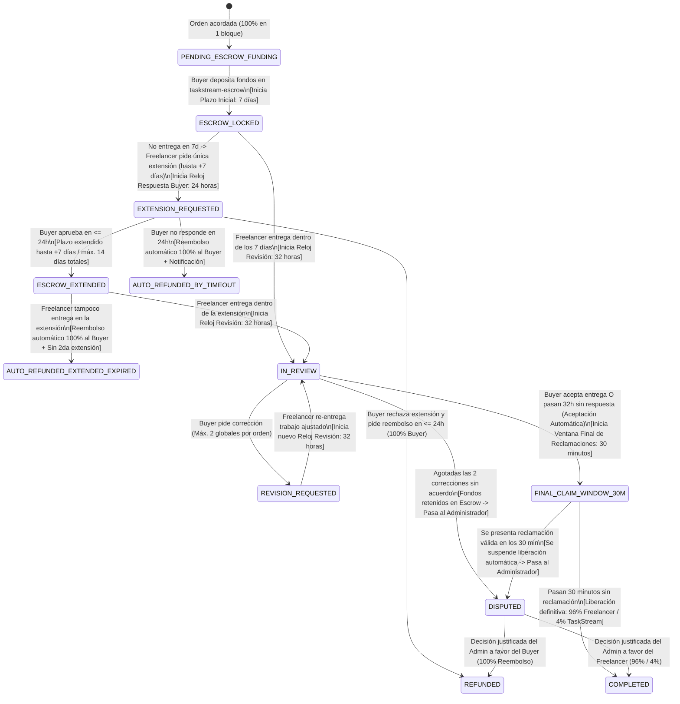
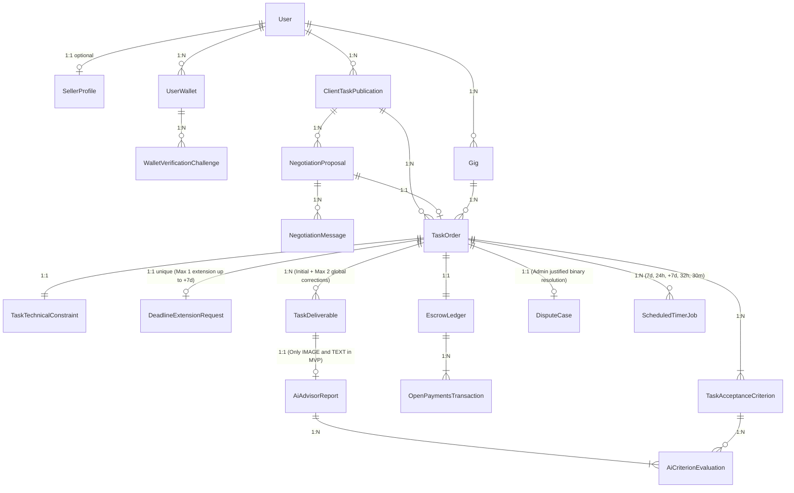

# Arquitectura General del Sistema, Flujo de Pagos y Modelo de Datos — TaskStream AI (`architecture-overview.md`)

> **Documento Oficial de Arquitectura (`architecture-overview.md`):** Define la arquitectura técnica integral de **TaskStream AI**, la estructura del proyecto, el **flujo completo de contratación, escrow, entregas, revisiones, extensiones, reclamaciones y pagos**, el contrato exacto del servicio de IA (**acotado en el MVP exclusivamente a tareas de imagen y texto**) y el **Modelo de Datos Relacional en PostgreSQL + Prisma 6** diseñado en Tercera Forma Normal (3NF), libre de *God-Entities* e incongruencias.
>
> 🔗 **Alineado con:** `CONTEXT.md`, `AGENTS.md`, `AI_USAGE.md`, `taskboard.md`, `pbp-development.md` y `sdd-process.md`.

---

## 1. Objetivo, Participantes y Visión Arquitectónica

**TaskStream AI** es un marketplace de tareas y servicios digitales para todo el continente americano que conecta a cuatro actores clave sobre el estándar abierto **Open Payments API v7.4.0** e **Interledger Protocol (ILP)**:

* **Buyer (Contratante):** Publica o contrata un trabajo, negocia el presupuesto (siempre menor o igual al presupuesto inicial planteado) y deposita el 100 % de los fondos de la orden.
* **Freelancer (Trabajador Independiente):** Realiza y entrega el trabajo contratado conforme a los requisitos y el alcance acordados.
* **TaskStream AI (Plataforma y Custodia en Escrow):** Facilita la contratación, mantiene el dinero de la orden en su cuenta de custodia (`taskstream-escrow`) mientras corresponde, ejecuta los relojes deterministas de plazos, genera las vistas protegidas (*Protected Preview*), brinda asesoría consultiva con IA para entregas de **imagen y texto**, y aplica las reglas de revisión, reembolso (**100 %**) y liberación de pagos (**96 % Freelancer / 4 % TaskStream**).
* **Administrador:** Interviene únicamente cuando existe una disputa o reclamación válida que no puede resolverse mediante el flujo normal, tomando una decisión binaria y justificada basada en las evidencias.

---

## 2. Flujo Completo de Contratación, Escrow, Entregas, Revisiones y Pagos

El dinero de toda orden se mantiene asegurado en el escrow de TaskStream hasta que se cumplan las condiciones deterministas para liberarlo o reembolsarlo.

### 2.1. Tabla Maestra de Plazos y Reglas Operativas

Los plazos del sistema son **independientes entre sí** y son gobernados en el Backend mediante colas deterministas en **BullMQ + Redis**:

| Situación / Reloj Determinista | Plazo | Regla de Negocio Inmutable |
| :--- | ---: | :--- |
| **Entrega inicial (`INITIAL_DELIVERY_7D`)** | **7 días** | Plazo inicial máximo para que el Freelancer entregue el trabajo desde que se activa la orden en escrow. |
| **Respuesta a solicitud de extensión (`EXTENSION_RESPONSE_24H`)** | **24 horas** | El Buyer debe aprobar o rechazar la solicitud de extensión. Si no responde en 24 horas, se activa el **reembolso automático del 100 %** al Buyer. |
| **Extensión de entrega (`EXTENDED_DELIVERY_UP_TO_7D`)** | **Hasta 7 días adicionales** | Solo puede solicitarse y aprobarse **una única vez por orden** (límite total de hasta **14 días** desde el inicio original). Si vence sin entrega, se procesa el **reembolso automático del 100 %**. |
| **Revisión de una entrega (`DELIVERY_REVIEW_32H`)** | **32 horas** | Plazo del Buyer para revisar cada entrega: puede aceptar, solicitar correcciones o dejar vencer el plazo (lo cual produce aceptación automática y abre la ventana final de 30 minutos). |
| **Ventana final de reclamaciones (`FINAL_CLAIM_WINDOW_30M`)** | **30 minutos** | Comienza después de una aceptación expresa o automática (tras vencer las 32 horas). Si transcurre sin reclamación, se libera el **96 % al Freelancer y 4 % a TaskStream**. |
| **Correcciones permitidas (`maxRevisions = 2`)** | **Máximo 2 por orden** | El límite es **global para toda la orden**: no se reinicia cuando se realiza una nueva entrega ni cuando se concede una extensión del plazo. |

---

### 2.2. Detalle Arquitectónico del Ciclo de Vida Financiero y de Ejecución

#### A. Inicio de una Orden y Depósito en Escrow
1. El Buyer contrata al Freelancer (ya sea desde un paquete publicado o tras llegar a un acuerdo de presupuesto `<= presupuesto inicial` en la sala de negociación) y deposita el **100 % de los fondos** en `taskstream-escrow` mediante una concesión interactiva de Open Payments (`IncomingPayment` con `receiveAmount = 100% USD`, asumiendo el Buyer el costo de conversión cambiaria FX).
2. La orden pasa a estar activa (`ESCROW_LOCKED`) y comienza el **plazo inicial de entrega de 7 días**.
3. El Freelancer debe entregar el trabajo conforme a los requisitos y el alcance acordados en la orden.

#### B. Si el Freelancer Entrega a Tiempo (Dentro de los Primeros 7 Días o de la Extensión Aprobada)
Cuando el Freelancer sube la entrega a Cloudflare R2 (`/originals`), el sistema genera el *Protected Preview* con marca de agua (`/previews`), ejecuta la auditoría consultiva de IA (si la tarea corresponde a **imagen o texto**) e inicia el **periodo de revisión de 32 horas** del Buyer (`IN_REVIEW`). Durante esas **32 horas**, el Buyer tiene tres caminos:

1. **Aceptar la entrega expresamente:**
   * La aceptación **no libera el dinero de inmediato**.
   * Se desbloquea el acceso al archivo original final y comienza la **ventana final de reclamaciones de 30 minutos** (`FINAL_CLAIM_WINDOW_30M`).
   * Si transcurren los **30 minutos** sin reclamación, el Worker libera automáticamente los fondos: **96 % para el Freelancer** y **4 % para TaskStream** (`COMPLETED`).
2. **No responder en 32 horas (Aceptación Automática por Inactividad):**
   * Si pasan las **32 horas** sin respuesta del Buyer, la entrega se considera **aceptada automáticamente**.
   * La falta de respuesta durante las 32 horas no libera inmediatamente los fondos: primero comienza la **ventana final de reclamaciones de 30 minutos** (`FINAL_CLAIM_WINDOW_30M`).
   * Si no se presenta ninguna reclamación durante esos **30 minutos**, se libera el **96 % al Freelancer** y el **4 % a TaskStream** (`COMPLETED`).
3. **Solicitar correcciones (Máximo 2 por orden):**
   * El Buyer puede pedir ajustes o reorganización dentro del alcance original hasta un **máximo global de 2 correcciones por orden** (`REVISION_REQUESTED`).
   * Cada vez que el Freelancer vuelve a entregar el trabajo corregido, comienza un **nuevo periodo de revisión de 32 horas** para el Buyer.
   * Si después de las correcciones hay acuerdo y el Buyer acepta (o vencen las 32 horas), comienza la ventana final de reclamaciones de **30 minutos** previa a la liberación **96 % / 4 %**.

#### C. Si No Hay Acuerdo Después de Agotar las 2 Correcciones (Disputa Administrativa)
Si se agotan las **2 correcciones** y las partes no logran llegar a un acuerdo, se abre una **disputa administrativa (`DISPUTED`)**:
* **Congelamiento de automatismos:** Los fondos permanecen retenidos en el escrow. Mientras la disputa siga abierta, **no se realiza ningún reembolso automático ni se libera automáticamente el pago al Freelancer**.
* **Evaluación basada en evidencias:** El Administrador revisa los requisitos y el alcance acordados originalmente, las entregas realizadas (`0`, `1` y `2`), las solicitudes de corrección y sus respuestas, los informes consultivos de IA (en tareas de imagen y texto) y los mensajes entre ambas partes.
* **Decisión binaria justificada:** Toda resolución administrativa debe ir acompañada de una justificación escrita basada en las evidencias:
  * **Si favorece al Buyer** (el Freelancer no cumplió los requisitos acordados): se reembolsa el **100 %** del importe reembolsable de la orden al Buyer (`REFUNDED`).
  * **Si favorece al Freelancer** (cumplió los requisitos y el Buyer rechaza injustificadamente o exige tareas fuera del alcance acordado): se libera el **96 % al Freelancer** y el **4 % a TaskStream** (`COMPLETED`).

#### D. Si el Freelancer No Entrega Dentro de los Primeros 7 Días (Flujo de Extensión Única de hasta 7 Días)
Si vence el plazo inicial de 7 días sin entrega (o el Freelancer requiere ampliar el plazo antes del vencimiento), puede solicitar **una única extensión de hasta 7 días adicionales** (`EXTENSION_REQUESTED`):
1. **Recepción y Ventana de 24 Horas del Buyer:** TaskStream notifica al Buyer, quien dispone de un máximo de **24 horas** para aprobar o rechazar la solicitud. No se permite una segunda extensión para la misma orden.
2. **Caso 1 — El Buyer aprueba la extensión (en $\le$ 24h):**
   * El Freelancer recibe **hasta 7 días adicionales**, contados a partir del vencimiento del plazo inicial (límite total de hasta **14 días** desde el inicio original de la orden).
   * La extensión cambia el plazo disponible para entregar, pero **no reinicia el contador global de 2 correcciones**.
   * Si el Freelancer entrega dentro del plazo extendido, se aplica el flujo normal de revisión de **32 horas**, máximo 2 correcciones globales y ventana final de **30 minutos**.
3. **Caso 2 — El Buyer rechaza la extensión y solicita el reembolso (en $\le$ 24h):**
   * TaskStream devuelve de inmediato el **100 %** del importe reembolsable de la orden al Buyer (`REFUNDED`, con opción de reabrir su publicación original de forma limpia si desea buscar otro freelancer).
4. **Caso 3 — El Buyer no responde en 24 horas (Reembolso Automático por Silencio):**
   * Al cumplirse las **24 horas** sin respuesta del Buyer, se activa el **reembolso automático del 100 %** del importe reembolsable hacia la billetera del Buyer (`AUTO_REFUNDED_BY_TIMEOUT`) y se notifica a ambas partes explicando el vencimiento del plazo inicial, la solicitud de extensión y la ejecución del reembolso por falta de respuesta.
5. **Caso 4 — El Buyer aprobó la extensión, pero el Freelancer tampoco entrega dentro del plazo extendido:**
   * Si vence el plazo extendido (hasta +7 días) sin que el Freelancer entregue, el Worker procesa un **reembolso automático del 100 %** del importe reembolsable al Buyer (`AUTO_REFUNDED_EXTENDED_EXPIRED`), no permite segunda extensión y notifica a ambas partes.

#### E. Regla de Suspensión y Resolución ante una Reclamación en la Ventana Final de 30 Minutos
Para cubrir de forma determinista el punto crítico de la **ventana final de 30 minutos (`FINAL_CLAIM_WINDOW_30M`)**:
1. **Suspensión Inmediata del Pago Automático:** Cuando el Buyer presenta una reclamación válida dentro de los 30 minutos posteriores a la aceptación expresa o automática (por ejemplo, al detectar tras desbloquear el archivo original final que este está corrupto o no coincide con la vista previa), el Backend **cancela de forma atómica el job `FINAL_CLAIM_WINDOW_30M` en BullMQ** y cambia el estado de la orden a `DISPUTED`.
2. **Prohibición de Ignorar la Reclamación:** Ningún pago puede liberarse automáticamente si existe una reclamación registrada dentro de esos 30 minutos.
3. **Revisión por el Administrador:** El Administrador evalúa la reclamación comparando el archivo original entregado frente a los requisitos de la orden y la vista previa:
   * Si la reclamación es procedente (incumplimiento o fraude en el archivo original), ejecuta el **reembolso del 100 % al Buyer** (`REFUNDED`).
   * Si la reclamación es improcedente y el entregable cumple los requisitos acordados, reanuda y ejecuta la liberación del **96 % al Freelancer y 4 % a TaskStream** (`COMPLETED`) con su respectiva justificación.

---

### 2.3. Diagrama de Máquina de Estados del Flujo Completo



---

## 3. Alcance del Motor de IA (`AiAdvisorService`) en el MVP y Contrato Exacto

### 3.1. Alcance Estricto en el MVP: Auditoría y Asesoría Exclusiva para Imagen y Texto

De conformidad con la definición de alcance en `CONTEXT.md`:

1. **En el MVP, `AiAdvisorService` únicamente audita y asesora tareas cuyos entregables sean de IMAGEN o TEXTO (`IMAGE_RASTER_VECTOR` y `DOCUMENT_TEXT`):**
   * **Entregables de Texto (`.txt`, `.md`, `.pdf`, `.docx`):** Evaluación semántica de cumplimiento de criterios de aceptación, conteo de palabras, estructura e integridad frente a los requisitos de la orden.
   * **Entregables de Imagen (`.png`, `.jpg`, `.webp`, `.svg`):** Evaluación multimodal visual y de dimensiones/formato frente a los criterios de aceptación acordados.
2. **Resto de Formatos y Modelo de Suscripción (Planteados para Post-MVP):**
   * La auditoría de IA para el resto de los tipos de archivo (video, audio, paquetes complejos de código o datasets masivos) y la idea de una suscripción para compradores (`Buyer AI Pro Subscription`) **quedan únicamente planteadas como visión futura y no entran dentro de la implementación del MVP**. En el MVP, dichas categorías operan normalmente con almacenamiento en R2, *Protected Preview* y los plazos de 32 horas / 30 minutos sin invocar auditoría de IA.

### 3.2. Contrato Exacto de Entrada (`AiAdvisorInputContractSchema`) para Generar `AiAdvisorReportSchema`

Para construir `AiAdvisorReportSchema` con total precisión (especificado en `SPEC-08.md`), el servicio `AiAdvisorService` recibe un **Contrato de Entrada Estrictamente Tipado (`AiAdvisorInputContractSchema`)** que le proporciona todo el contexto determinista de la orden antes de invocar al modelo:

```typescript
import { z } from 'zod';

/**
 * MODALIDADES AUDITABLES POR IA EN EL MVP (Exclusivamente Imagen y Texto)
 */
export const MvpAiAuditableModalityEnum = z.enum([
  'IMAGE', // .png, .jpg, .webp, .svg
  'TEXT',  // .txt, .md, .pdf, .docx
]);

/**
 * CONTRATO EXACTO DE ENTRADA QUE RECIBE AiAdvisorService (Definido para SPEC-08)
 */
export const AiAdvisorInputContractSchema = z.object({
  taskOrderId: z.string().uuid(),
  deliverableId: z.string().uuid(),
  revisionNumber: z.number().int().min(0).max(2)
    .describe('0 = Entrega inicial, 1 = Corrección 1, 2 = Corrección 2'),
  category: z.enum([
    'DIGITAL_MARKETING',
    'GRAPHICS_AND_DESIGN',
    'PROGRAMMING_AND_TECH',
    'TECHNICAL_WRITING_TRANS',
    'VIDEO_AND_ANIMATION',
    'MUSIC_AND_AUDIO',
  ]),
  auditableModality: MvpAiAuditableModalityEnum
    .describe('En el MVP solo se auditan entregas de tipo IMAGE o TEXT'),
  orderContext: z.object({
    title: z.string(),
    scopeDescription: z.string(),
    acceptanceCriteria: z.array(
      z.object({
        criterionId: z.string(),
        description: z.string(),
        isMandatory: z.boolean(),
      })
    ).min(1),
    previousRevisionNotes: z.array(z.string()).optional()
      .describe('Solicitudes de corrección previas del Buyer si revisionNumber > 0'),
  }),
  deliverableArtifact: z.object({
    fileName: z.string(),
    mimeType: z.string(),
    fileExtension: z.string(),
    fileSizeBytes: z.number().int().positive(),
    sha256Checksum: z.string().length(64),
    // Datos extraídos para evaluación determinista y consultiva (Imagen o Texto)
    extractedTextContent: z.string().optional()
      .describe('Texto plano extraído y encapsulado en <untrusted_deliverable_artifact> cuando auditableModality == TEXT'),
    wordCount: z.number().int().nonnegative().optional(),
    imageSignedUrlOrBase64: z.string().optional()
      .describe('Imagen para análisis multimodal cuando auditableModality == IMAGE'),
    imageDimensions: z.object({
      widthPx: z.number().int().positive(),
      heightPx: z.number().int().positive(),
    }).optional(),
  }),
  deterministicPreCheckResult: z.object({
    extensionAllowed: z.boolean(),
    nonEmptyFile: z.boolean(),
    technicalConstraintsMet: z.boolean(),
    failureReasons: z.array(z.string()),
  }),
});
```

A partir de este `AiAdvisorInputContractSchema`, el servicio `AiAdvisorService` produce como salida el `AiAdvisorReportSchema` (puntaje orientativo `0–100`, evaluación individual de cada `criterionId`, resumen ejecutivo para el Buyer, sugerencias para el Freelancer en caso de pedir una de sus 2 correcciones y descargo de responsabilidad confirmando que la IA nunca libera ni bloquea pagos).

---

## 4. Estructura del Proyecto (Monorepo Turborepo)

El repositorio está estructurado para que los **5 desarrolladores (`2 Frontend: FE-1, FE-2 / 2 Backend: BE-1, BE-2 / 1 IA: AI-1`)** trabajen de forma modular y sin bloqueos:

```text
Haki-Suave/ (TaskStream AI)
├── .agents/
│   ├── CONTEXT.md                             # Única Fuente de Verdad (SSoT)
│   └── skills/                                # Herramientas de apoyo al diseño
├── specs/                                     # Carpeta de especificaciones (Creada en SPEC-00)
│   ├── README.md                              # Índice y guía de especificaciones
│   ├── SPEC-00.md                             # Creación de estructura specs y README
│   ├── SPEC-01.md ... SPEC-11.md              # Especificaciones de módulos del MVP
│   └── SPEC-12.md                             # Especificación final de Deploy
├── prompts/
│   └── AI_USAGE.md                            # Registro íntegro de prompts (Política Hackathon)
├── packages/
│   └── shared-schemas/                        # Contratos Zod compartidos (Orden, Pagos, Plazos, IA)
├── apps/
│   ├── web/                                   # Next.js 15.5 + React 19 (FE-1: UI/Flujos | FE-2: 3D ScrollTrigger & Previews)
│   └── api/                                   # NestJS 10.4 + Prisma 6 + BullMQ (BE-1: Open Payments Manual | BE-2: R2 & Timers | AI-1: AiAdvisorService)
├── AGENTS.md                                  # Reglas globales de gobernanza
├── AI_USAGE.md                                # Registro auditable de uso de IA
├── promptsAI_USAGE.md                         # Bitácora íntegra de prompts en raíz
├── architecture-overview.md                   # Arquitectura general y modelo de datos
├── taskboard.md                               # Tablero de tareas, prioridades y decisiones
├── pbp-development.md                         # Desarrollo fase por fase por roles
└── sdd-process.md                             # Proceso general SDD del proyecto
```

---

## 5. Modelado de la Base de Datos (PostgreSQL + Prisma 6) — Libre de *God-Entities*

### 5.1. Verificación de Limpieza del Modelo Relacional (3NF)

El modelo de datos ha sido diseñado verificando la ausencia total de *God-Entities*, redundancias o estados contradictorios:

1. **Separación de Responsabilidades (Sin *God-Entity* en `TaskOrder` ni en `User`):**
   * `User` contiene únicamente la identidad base; el perfil profesional del trabajador vive en `SellerProfile` (1:1 opcional) y sus billeteras multimoneda en `UserWallet` (1:N).
   * La oferta abierta del cliente (`ClientTaskPublication`), las negociaciones (`NegotiationProposal`), la orden activa (`TaskOrder`), el libro contable del escrow (`EscrowLedger`), las transacciones de Open Payments (`OpenPaymentsTransaction`), la solicitud única de extensión (`DeadlineExtensionRequest`), las entregas (`TaskDeliverable`), los informes consultivos de IA para imagen y texto (`AiAdvisorReport`), las disputas administrativas (`DisputeCase`) y los relojes de BullMQ (`ScheduledTimerJob`) están separados en tablas cohesivas.
2. **Cumplimiento Exacto de las Reglas de Plazos y Pagos en el Esquema:**
   * **Plazo inicial de 7 días y extensión única de hasta 7 días adicionales (máximo 14 días):** `DeadlineExtensionRequest` tiene restricción `UNIQUE` sobre `taskOrderId` (garantizando a nivel de motor de base de datos que **jamás pueda existir una segunda extensión para la misma orden**) y valida que `requestedExtraDays` esté entre `1` y `7`, con `buyerDecisionDeadlineAt` a **24 horas**.
   * **Revisión de 32 horas por entrega y máximo 2 correcciones globales:** `TaskOrder` mantiene el contador global `revisionsUsed` (`0..2`) que nunca se reinicia al aprobar una extensión, y cada nueva entrega (`TaskDeliverable`) programa un nuevo reloj de **32 horas** (`DELIVERY_REVIEW_32H`).
   * **Ventana final de 30 minutos y suspensión por reclamación:** Al aceptarse una entrega (expresa o automáticamente tras las 32 horas), se programa `FINAL_CLAIM_WINDOW_30M` por **30 minutos**; si entra una reclamación o se agotan las 2 correcciones sin acuerdo, se crea el registro en `DisputeCase` con justificación obligatoria (`resolutionJustification`) y decisión binaria (`BUYER_FULL_REFUND_100` o `SELLER_RELEASE_96_4`).

---

### 5.2. Diagrama Entidad-Relación (`erDiagram`)



---

### 5.3. Esquema Completo en Prisma 6 (`schema.prisma`)

```prisma
// schema.prisma
generator client {
  provider = "prisma-client-js"
}

datasource db {
  provider  = "postgresql"
  url       = env("DATABASE_URL")
  directUrl = env("DIRECT_URL")
}

// ============================================================================
// 1. ENUMS DEL DOMINIO
// ============================================================================

enum UserActiveMode {
  BUYER
  SELLER
}

enum PlatformRole {
  USER
  ADMIN
}

enum WalletVerificationStatus {
  PENDING_REDIRECT
  VERIFIED
  FAILED
  EXPIRED
}

enum TaskCategory {
  DIGITAL_MARKETING
  GRAPHICS_AND_DESIGN
  PROGRAMMING_AND_TECH
  TECHNICAL_WRITING_TRANS
  VIDEO_AND_ANIMATION
  MUSIC_AND_AUDIO
}

enum DeliverableMediaType {
  IMAGE_RASTER_VECTOR // Auditable por IA en el MVP (Imagen)
  DOCUMENT_TEXT       // Auditable por IA en el MVP (Texto)
  CODE_ARCHIVE        // Planteado para IA Post-MVP
  DATA_CAMPAIGN       // Planteado para IA Post-MVP
  VIDEO_STREAM        // Planteado para IA Post-MVP
  AUDIO_TRACK         // Planteado para IA Post-MVP
}

enum MvpAiAuditableModality {
  IMAGE
  TEXT
}

enum PublicationStatus {
  OPEN_FOR_PROPOSALS
  AGREED_AND_LOCKED
  CANCELLED
}

enum NegotiationProposalStatus {
  IN_NEGOTIATION
  AGREED_PATH_1
  DISCREPANCY_CLOSED_PATH_2
}

enum TaskLifecycleStatus {
  PENDING_ESCROW_FUNDING
  ESCROW_LOCKED                  // Plazo inicial de 7 días activo
  EXTENSION_REQUESTED            // Solicitud única de hasta +7 días; Buyer tiene 24h para responder
  ESCROW_EXTENDED                // Extensión aprobada (hasta 14 días totales desde el inicio)
  IN_REVIEW                      // Entrega realizada; Buyer tiene 32 horas para revisar
  REVISION_REQUESTED             // Solicitud de corrección activa (Máximo 2 globales por orden)
  FINAL_CLAIM_WINDOW_30M         // Aceptación expresa o automática (tras 32h); ventana final de 30 minutos
  DISPUTED                       // Disputa administrativa (tras 2 correcciones sin acuerdo o reclamación en los 30m)
  COMPLETED                      // Liberación definitiva: 96% Freelancer / 4% TaskStream
  REFUNDED                       // Reembolso 100% al Buyer (por rechazo de extensión o fallo de disputa)
  REFUNDED_AND_REOPENED          // Reembolso 100% al Buyer con reapertura limpia de la publicación
  AUTO_REFUNDED_BY_TIMEOUT       // Reembolso automático 100% al Buyer por falta de respuesta en 24h a extensión
  AUTO_REFUNDED_EXTENDED_EXPIRED // Reembolso automático 100% al Buyer por no entregar dentro de la extensión
}

enum ExtensionRequestStatus {
  PENDING_BUYER_DECISION
  APPROVED_EXTRA_DAYS
  REJECTED_REFUND_REQUESTED
  REJECTED_BY_TIMEOUT_AUTO_REFUNDED
}

enum EscrowLedgerStatus {
  AWAITING_FUNDS
  FUNDS_LOCKED
  RELEASED_96_4
  REFUNDED_100
}

enum OpenPaymentsOperationType {
  ESCROW_LOCK
  FREELANCER_PAYOUT_96_4
  BUYER_REFUND_100
}

enum OpenPaymentsTxStatus {
  PENDING_INTERACTION
  PROCESSING
  COMPLETED
  FAILED
  CANCELLED
}

enum PreviewProcessingStatus {
  PENDING_PROCESSING
  READY
  FAILED
}

enum AiAdvisoryLabel {
  HIGH_COMPLIANCE
  PARTIAL_COMPLIANCE
  LOW_COMPLIANCE
}

enum CriterionEvalStatus {
  MET
  PARTIALLY_MET
  NOT_MET
  REQUIRES_HUMAN_VERIFICATION
}

enum DisputeOriginType {
  EXHAUSTED_2_REVISIONS_NO_AGREEMENT
  FINAL_30M_CLAIM_WINDOW
}

enum AdminBinaryResolution {
  PENDING
  BUYER_FULL_REFUND_100
  SELLER_RELEASE_96_4
}

enum TimerJobType {
  INITIAL_DELIVERY_7D        // 7 días iniciales de entrega
  EXTENSION_RESPONSE_24H     // 24 horas para que el Buyer responda a la extensión
  EXTENDED_DELIVERY_UP_TO_7D // Hasta 7 días adicionales aprobados (máx. 14 días totales)
  DELIVERY_REVIEW_32H        // 32 horas para que el Buyer revise una entrega
  FINAL_CLAIM_WINDOW_30M     // 30 minutos de ventana final antes de liberar 96% / 4%
}

enum TimerJobStatus {
  SCHEDULED
  EXECUTED
  CANCELLED_BY_ACTION
  SUSPENDED_BY_DISPUTE
  FAILED
}

// ============================================================================
// 2. IDENTIDAD, PERFILES Y BILLETERAS MULTIMONEDA
// ============================================================================

model User {
  id           String         @id @default(uuid()) @db.Uuid
  clerkId      String         @unique @map("clerk_id")
  email        String         @unique
  displayName  String         @map("display_name") @db.VarChar(100)
  avatarUrl    String?        @map("avatar_url")
  countryCode  String         @map("country_code") @db.Char(2)
  activeMode   UserActiveMode @default(BUYER) @map("active_mode")
  platformRole PlatformRole   @default(USER) @map("platform_role")
  createdAt    DateTime       @default(now()) @map("created_at")
  updatedAt    DateTime       @updatedAt @map("updated_at")

  sellerProfile           SellerProfile?
  wallets                 UserWallet[]
  gigs                    Gig[]                      @relation("SellerGigs")
  publications            ClientTaskPublication[]    @relation("BuyerPublications")
  buyerNegotiations       NegotiationProposal[]      @relation("BuyerNegotiations")
  freelancerNegotiations  NegotiationProposal[]      @relation("FreelancerNegotiations")
  sentNegotiationMessages NegotiationMessage[]       @relation("MessageSender")
  buyerTaskOrders         TaskOrder[]                @relation("BuyerOrders")
  sellerTaskOrders        TaskOrder[]                @relation("SellerOrders")
  requestedExtensions     DeadlineExtensionRequest[] @relation("ExtensionRequester")
  openedDisputes          DisputeCase[]              @relation("DisputeOpener")
  resolvedDisputes        DisputeCase[]              @relation("DisputeAdminReviewer")

  @@index([countryCode])
  @@map("users")
}

model SellerProfile {
  id                     String   @id @default(uuid()) @db.Uuid
  userId                 String   @unique @map("user_id") @db.Uuid
  headline               String   @db.VarChar(140)
  bio                    String   @db.Text
  skills                 String[]
  languages              String[]
  webMonetizationEnabled Boolean  @default(true) @map("web_monetization_enabled")
  ratingAvg              Decimal  @default(0.00) @map("rating_avg") @db.Decimal(3, 2)
  completedOrdersCount   Int      @default(0) @map("completed_orders_count")
  aiAdvisoryScoreAvg     Decimal  @default(0.00) @map("ai_advisory_score_avg") @db.Decimal(5, 2)
  createdAt              DateTime @default(now()) @map("created_at")
  updatedAt              DateTime @updatedAt @map("updated_at")

  user User @relation(fields: [userId], references: [id], onDelete: Cascade)

  @@map("seller_profiles")
}

model UserWallet {
  id                String    @id @default(uuid()) @db.Uuid
  userId            String    @map("user_id") @db.Uuid
  walletAddressUrl  String    @unique @map("wallet_address_url")
  assetCode         String    @map("asset_code") @db.VarChar(6)
  assetScale        Int       @map("asset_scale")
  authServerUrl     String    @map("auth_server_url")
  resourceServerUrl String    @map("resource_server_url")
  isVerified        Boolean   @default(false) @map("is_verified")
  verifiedAt        DateTime? @map("verified_at")
  isPrimary         Boolean   @default(true) @map("is_primary")
  createdAt         DateTime  @default(now()) @map("created_at")
  updatedAt         DateTime  @updatedAt @map("updated_at")

  user                   User                          @relation(fields: [userId], references: [id], onDelete: Cascade)
  verificationChallenges WalletVerificationChallenge[]
  buyerOrders            TaskOrder[]                   @relation("BuyerOrderWallet")
  sellerOrders           TaskOrder[]                   @relation("SellerOrderWallet")

  @@index([userId, isPrimary])
  @@map("user_wallets")
}

model WalletVerificationChallenge {
  id                  String                   @id @default(uuid()) @db.Uuid
  walletId            String                   @map("wallet_id") @db.Uuid
  clientNonce         String                   @unique @map("client_nonce")
  continueUri         String                   @map("continue_uri")
  continueAccessToken String                   @map("continue_access_token")
  interactRedirectUri String                   @map("interact_redirect_uri")
  interactRef         String?                  @map("interact_ref")
  receivedHash        String?                  @map("received_hash")
  status              WalletVerificationStatus @default(PENDING_REDIRECT)
  expiresAt           DateTime                 @map("expires_at")
  createdAt           DateTime                 @default(now()) @map("created_at")
  completedAt         DateTime?                @map("completed_at")

  wallet UserWallet @relation(fields: [walletId], references: [id], onDelete: Cascade)

  @@index([walletId, status])
  @@map("wallet_verification_challenges")
}

// ============================================================================
// 3. MARKETPLACE, PUBLICACIONES Y NEGOCIACIÓN
// ============================================================================

model Gig {
  id                  String               @id @default(uuid()) @db.Uuid
  sellerId            String               @map("seller_id") @db.Uuid
  category            TaskCategory
  expectedMediaType   DeliverableMediaType @map("expected_media_type")
  title               String               @db.VarChar(120)
  description         String               @db.Text
  priceUSDInCents     Int                  @map("price_usd_in_cents")
  initialDeliveryDays Int                  @default(7) @map("initial_delivery_days") // Máx. 7 días iniciales
  defaultCriteriaJson Json                 @map("default_criteria_json")
  allowedExtensions   String[]             @map("allowed_extensions")
  isActive            Boolean              @default(true) @map("is_active")
  createdAt           DateTime             @default(now()) @map("created_at")
  updatedAt           DateTime             @updatedAt @map("updated_at")

  seller     User        @relation("SellerGigs", fields: [sellerId], references: [id], onDelete: Restrict)
  taskOrders TaskOrder[]

  @@index([category, isActive])
  @@index([sellerId])
  @@map("gigs")
}

model ClientTaskPublication {
  id                      String               @id @default(uuid()) @db.Uuid
  buyerId                 String               @map("buyer_id") @db.Uuid
  category                TaskCategory
  expectedMediaType       DeliverableMediaType @map("expected_media_type")
  title                   String               @db.VarChar(120)
  description             String               @db.Text
  initialBudgetUSDInCents Int                  @map("initial_budget_usd_in_cents")
  initialDeliveryDays     Int                  @default(7) @map("initial_delivery_days") // Máx. 7 días iniciales
  preliminaryCriteriaJson Json                 @map("preliminary_criteria_json")
  allowedExtensions       String[]             @map("allowed_extensions")
  status                  PublicationStatus    @default(OPEN_FOR_PROPOSALS)
  republishCount          Int                  @default(0) @map("republish_count")
  createdAt               DateTime             @default(now()) @map("created_at")
  updatedAt               DateTime             @updatedAt @map("updated_at")

  buyer      User                  @relation("BuyerPublications", fields: [buyerId], references: [id], onDelete: Restrict)
  proposals  NegotiationProposal[]
  taskOrders TaskOrder[]

  @@index([status, category])
  @@index([buyerId])
  @@map("client_task_publications")
}

model NegotiationProposal {
  id                       String                    @id @default(uuid()) @db.Uuid
  publicationId            String                    @map("publication_id") @db.Uuid
  buyerId                  String                    @map("buyer_id") @db.Uuid
  freelancerId             String                    @map("freelancer_id") @db.Uuid
  initialBudgetUSDInCents  Int                       @map("initial_budget_usd_in_cents")
  proposedBudgetUSDInCents Int                       @map("proposed_budget_usd_in_cents") // <= initialBudgetUSDInCents
  status                   NegotiationProposalStatus @default(IN_NEGOTIATION)
  closedReason             String?                   @map("closed_reason") @db.VarChar(250)
  createdAt                DateTime                  @default(now()) @map("created_at")
  updatedAt                DateTime                  @updatedAt @map("updated_at")
  closedAt                 DateTime?                 @map("closed_at")

  publication ClientTaskPublication @relation(fields: [publicationId], references: [id], onDelete: Cascade)
  buyer       User                  @relation("BuyerNegotiations", fields: [buyerId], references: [id], onDelete: Restrict)
  freelancer  User                  @relation("FreelancerNegotiations", fields: [freelancerId], references: [id], onDelete: Restrict)
  messages    NegotiationMessage[]
  taskOrder   TaskOrder?

  @@index([publicationId, status])
  @@index([freelancerId, status])
  @@map("negotiation_proposals")
}

model NegotiationMessage {
  id                      String   @id @default(uuid()) @db.Uuid
  proposalId              String   @map("proposal_id") @db.Uuid
  senderId                String   @map("sender_id") @db.Uuid
  messageText             String   @map("message_text") @db.Text
  offeredAmountUSDInCents Int?     @map("offered_amount_usd_in_cents")
  createdAt               DateTime @default(now()) @map("created_at")

  proposal NegotiationProposal @relation(fields: [proposalId], references: [id], onDelete: Cascade)
  sender   User                @relation("MessageSender", fields: [senderId], references: [id], onDelete: Restrict)

  @@index([proposalId, createdAt])
  @@map("negotiation_messages")
}

// ============================================================================
// 4. ORDEN DE TAREA, PLAZOS (7d, 24h, +7d, 32h, 30m) Y CORRECCIONES (MÁX. 2)
// ============================================================================

model TaskOrder {
  id                          String                  @id @default(uuid()) @db.Uuid
  buyerId                     String                  @map("buyer_id") @db.Uuid
  sellerId                    String                  @map("seller_id") @db.Uuid
  buyerWalletId               String                  @map("buyer_wallet_id") @db.Uuid
  sellerWalletId              String                  @map("seller_wallet_id") @db.Uuid
  publicationId               String?                 @map("publication_id") @db.Uuid
  proposalId                  String?                 @unique @map("proposal_id") @db.Uuid
  gigId                       String?                 @map("gig_id") @db.Uuid
  title                       String                  @db.VarChar(120)
  scopeDescription            String                  @map("scope_description") @db.Text
  category                    TaskCategory
  expectedMediaType           DeliverableMediaType    @map("expected_media_type")
  aiAuditableModality         MvpAiAuditableModality? @map("ai_auditable_modality") // Presente solo si es IMAGE o TEXT en el MVP
  lifecycleStatus             TaskLifecycleStatus     @default(PENDING_ESCROW_FUNDING) @map("lifecycle_status")

  // Distribución de Fondos (96% Freelancer / 4% TaskStream)
  totalAmountUSDInCents       Int                     @map("total_amount_usd_in_cents")       // 100%
  freelancerPayoutUSDInCents  Int                     @map("freelancer_payout_usd_in_cents")  // 96%
  platformFeeUSDInCents       Int                     @map("platform_fee_usd_in_cents")       // 4%
  buyerOriginCurrency         String                  @map("buyer_origin_currency") @db.VarChar(6)
  sellerTargetCurrency        String                  @map("seller_target_currency") @db.VarChar(6)

  // Reglas Globales de Plazos y Correcciones
  initialDeliveryDays         Int                     @default(7) @map("initial_delivery_days")     // 7 días iniciales
  reviewWindowHours           Int                     @default(32) @map("review_window_hours")      // 32 horas por cada entrega
  finalClaimWindowMinutes     Int                     @default(30) @map("final_claim_window_minutes") // 30 minutos ventana final
  maxRevisionsAllowed         Int                     @default(2) @map("max_revisions_allowed")     // Máximo 2 por orden
  revisionsUsed               Int                     @default(0) @map("revisions_used")            // Global (0..2), no se reinicia con extensión
  extensionGrantedDays        Int                     @default(0) @map("extension_granted_days")    // 0 o 1..7 días adicionales (máx. 14d totales)

  // Marcas de Tiempo de los Relojes Independientes
  escrowLockedAt              DateTime?               @map("escrow_locked_at")
  initialDeliveryDeadlineAt   DateTime?               @map("initial_delivery_deadline_at")  // +7 días desde inicio
  extendedDeliveryDeadlineAt  DateTime?               @map("extended_delivery_deadline_at") // Hasta +7 días adicionales (máx. 14d desde inicio)
  currentReviewStartedAt      DateTime?               @map("current_review_started_at")
  currentReviewExpiresAt      DateTime?               @map("current_review_expires_at")     // +32 horas desde la entrega vigente
  finalClaimWindowStartedAt   DateTime?               @map("final_claim_window_started_at")
  finalClaimWindowExpiresAt   DateTime?               @map("final_claim_window_expires_at") // +30 minutos tras aceptación expresa o automática
  completedAt                 DateTime?               @map("completed_at")
  refundedAt                  DateTime?               @map("refunded_at")
  createdAt                   DateTime                @default(now()) @map("created_at")
  updatedAt                   DateTime                @updatedAt @map("updated_at")

  buyer                User                      @relation("BuyerOrders", fields: [buyerId], references: [id], onDelete: Restrict)
  seller               User                      @relation("SellerOrders", fields: [sellerId], references: [id], onDelete: Restrict)
  buyerWallet          UserWallet                @relation("BuyerOrderWallet", fields: [buyerWalletId], references: [id], onDelete: Restrict)
  sellerWallet         UserWallet                @relation("SellerOrderWallet", fields: [sellerWalletId], references: [id], onDelete: Restrict)
  publication          ClientTaskPublication?    @relation(fields: [publicationId], references: [id], onDelete: SetNull)
  proposal             NegotiationProposal?      @relation(fields: [proposalId], references: [id], onDelete: SetNull)
  gig                  Gig?                      @relation(fields: [gigId], references: [id], onDelete: SetNull)
  acceptanceCriteria   TaskAcceptanceCriterion[]
  technicalConstraint  TaskTechnicalConstraint?
  extensionRequest     DeadlineExtensionRequest?
  escrowLedger         EscrowLedger?
  openPaymentsTxs      OpenPaymentsTransaction[]
  deliverables         TaskDeliverable[]
  aiAdvisorReports     AiAdvisorReport[]
  disputeCase          DisputeCase?
  scheduledTimerJobs   ScheduledTimerJob[]

  @@index([buyerId, lifecycleStatus])
  @@index([sellerId, lifecycleStatus])
  @@index([lifecycleStatus])
  @@map("task_orders")
}

model TaskAcceptanceCriterion {
  id            String  @id @default(uuid()) @db.Uuid
  taskOrderId   String  @map("task_order_id") @db.Uuid
  criterionCode String  @map("criterion_code") @db.VarChar(32)
  description   String  @db.VarChar(350)
  isMandatory   Boolean @default(true) @map("is_mandatory")
  sortOrder     Int     @default(0) @map("sort_order")

  taskOrder     TaskOrder               @relation(fields: [taskOrderId], references: [id], onDelete: Cascade)
  aiEvaluations AiCriterionEvaluation[]

  @@unique([taskOrderId, criterionCode])
  @@map("task_acceptance_criteria")
}

model TaskTechnicalConstraint {
  taskOrderId        String   @id @map("task_order_id") @db.Uuid
  allowedExtensions  String[] @map("allowed_extensions")
  maxFileSizeBytes   BigInt?  @map("max_file_size_bytes") // NULL en MVP
  minWordCount       Int?     @map("min_word_count")
  minWidthPx         Int?     @map("min_width_px")
  minHeightPx        Int?     @map("min_height_px")
  minDurationSeconds Int?     @map("min_duration_seconds")
  maxDurationSeconds Int?     @map("max_duration_seconds")

  taskOrder TaskOrder @relation(fields: [taskOrderId], references: [id], onDelete: Cascade)

  @@map("task_technical_constraints")
}

model DeadlineExtensionRequest {
  id                      String                 @id @default(uuid()) @db.Uuid
  taskOrderId             String                 @unique @map("task_order_id") @db.Uuid // Garantiza 1 única extensión por orden
  requestedById           String                 @map("requested_by_id") @db.Uuid
  requestedExtraDays      Int                    @map("requested_extra_days")          // Hasta 7 días adicionales (1..7)
  reason                  String                 @db.VarChar(500)
  requestedAt             DateTime               @default(now()) @map("requested_at")
  buyerDecisionDeadlineAt DateTime               @map("buyer_decision_deadline_at")    // +24 horas para aprobar o rechazar
  respondedAt             DateTime?              @map("responded_at")
  status                  ExtensionRequestStatus @default(PENDING_BUYER_DECISION)

  taskOrder   TaskOrder @relation(fields: [taskOrderId], references: [id], onDelete: Cascade)
  requestedBy User      @relation("ExtensionRequester", fields: [requestedById], references: [id], onDelete: Restrict)

  @@index([status, buyerDecisionDeadlineAt])
  @@map("deadline_extension_requests")
}

// ============================================================================
// 5. LIBRO MAYOR EN ESCROW Y TRANSACCIONES OPEN PAYMENTS
// ============================================================================

model EscrowLedger {
  id                         String             @id @default(uuid()) @db.Uuid
  taskOrderId                String             @unique @map("task_order_id") @db.Uuid
  escrowWalletAddress        String             @default("https://ilp.interledger-test.dev/taskstream-escrow") @map("escrow_wallet_address")
  lockedAmountUSDInCents     Int                @default(0) @map("locked_amount_usd_in_cents")
  releasedToSellerUSDInCents Int                @default(0) @map("released_to_seller_usd_in_cents")
  platformFeeRetainedInCents Int                @default(0) @map("platform_fee_retained_in_cents")
  refundedToBuyerUSDInCents  Int                @default(0) @map("refunded_to_buyer_usd_in_cents")
  status                     EscrowLedgerStatus @default(AWAITING_FUNDS)
  createdAt                  DateTime           @default(now()) @map("created_at")
  updatedAt                  DateTime           @updatedAt @map("updated_at")

  taskOrder    TaskOrder                 @relation(fields: [taskOrderId], references: [id], onDelete: Restrict)
  transactions OpenPaymentsTransaction[]

  @@map("escrow_ledgers")
}

model OpenPaymentsTransaction {
  id                  String                    @id @default(uuid()) @db.Uuid
  escrowLedgerId      String                    @map("escrow_ledger_id") @db.Uuid
  taskOrderId         String                    @map("task_order_id") @db.Uuid
  operationType       OpenPaymentsOperationType @map("operation_type")
  attemptNumber       Int                       @default(1) @map("attempt_number")
  idempotencyKey      String                    @unique @map("idempotency_key")
  incomingPaymentUrl  String?                   @map("incoming_payment_url")
  quoteUrl            String?                   @map("quote_url")
  outgoingPaymentUrl  String?                   @map("outgoing_payment_url")
  grantContinueUri    String?                   @map("grant_continue_uri")
  grantContinueToken  String?                   @map("grant_continue_token")
  interactRedirectUri String?                   @map("interact_redirect_uri")
  clientNonce         String?                   @map("client_nonce")
  debitAmountValue    String?                   @map("debit_amount_value")
  debitAssetCode      String?                   @map("debit_asset_code") @db.VarChar(6)
  debitAssetScale     Int?                      @map("debit_asset_scale")
  receiveAmountValue  String?                   @map("receive_amount_value")
  receiveAssetCode    String?                   @map("receive_asset_code") @db.VarChar(6)
  receiveAssetScale   Int?                      @map("receive_asset_scale")
  status              OpenPaymentsTxStatus      @default(PENDING_INTERACTION)
  failureReason       String?                   @map("failure_reason")
  metadataJson        Json?                     @map("metadata_json")
  createdAt           DateTime                  @default(now()) @map("created_at")
  completedAt         DateTime?                 @map("completed_at")

  escrowLedger EscrowLedger @relation(fields: [escrowLedgerId], references: [id], onDelete: Restrict)
  taskOrder    TaskOrder    @relation(fields: [taskOrderId], references: [id], onDelete: Restrict)

  @@index([taskOrderId, operationType])
  @@index([status])
  @@map("open_payments_transactions")
}

model RafikiWebhookEvent {
  id          String    @id @default(uuid()) @db.Uuid
  eventId     String    @unique @map("event_id")
  eventType   String    @map("event_type") @db.VarChar(80)
  resourceUrl String    @map("resource_url")
  payloadJson Json      @map("payload_json")
  processedAt DateTime? @map("processed_at")
  createdAt   DateTime  @default(now()) @map("created_at")

  @@index([eventType, processedAt])
  @@map("rafiki_webhook_events")
}

// ============================================================================
// 6. ENTREGABLES, CONSEJERO DE IA (IMAGEN Y TEXTO EN MVP) Y DISPUTAS
// ============================================================================

model TaskDeliverable {
  id                 String                  @id @default(uuid()) @db.Uuid
  taskOrderId        String                  @map("task_order_id") @db.Uuid
  revisionNumber     Int                     @map("revision_number") // 0 = Inicial, 1 = Corrección 1, 2 = Corrección 2
  originalR2Key      String                  @map("original_r2_key")
  previewR2Key       String?                 @map("preview_r2_key")
  fileName           String                  @map("file_name") @db.VarChar(255)
  mimeType           String                  @map("mime_type") @db.VarChar(120)
  fileExtension      String                  @map("file_extension") @db.VarChar(20)
  fileSizeBytes      BigInt                  @map("file_size_bytes")
  sha256Checksum     String                  @map("sha256_checksum") @db.Char(64)
  previewStatus      PreviewProcessingStatus @default(PENDING_PROCESSING) @map("preview_status")
  isOriginalUnlocked Boolean                 @default(false) @map("is_original_unlocked")
  buyerRevisionNotes String?                 @map("buyer_revision_notes") @db.Text
  reviewStartedAt    DateTime                @default(now()) @map("review_started_at")
  reviewExpiresAt    DateTime                @map("review_expires_at") // +32 horas para esta entrega
  submittedAt        DateTime                @default(now()) @map("submitted_at")
  unlockedAt         DateTime?               @map("unlocked_at")

  taskOrder       TaskOrder        @relation(fields: [taskOrderId], references: [id], onDelete: Cascade)
  aiAdvisorReport AiAdvisorReport?

  @@unique([taskOrderId, revisionNumber])
  @@index([taskOrderId, previewStatus])
  @@map("task_deliverables")
}

model AiAdvisorReport {
  id                           String                 @id @default(uuid()) @db.Uuid
  deliverableId                String                 @unique @map("deliverable_id") @db.Uuid
  taskOrderId                  String                 @map("task_order_id") @db.Uuid
  revisionEvaluated            Int                    @map("revision_evaluated")
  auditableModality            MvpAiAuditableModality @map("auditable_modality") // IMAGE | TEXT en MVP
  advisoryScore                Int                    @map("advisory_score")     // 0..100
  advisoryLabel                AiAdvisoryLabel        @map("advisory_label")
  executiveSummaryForBuyer     String                 @map("executive_summary_for_buyer") @db.VarChar(500)
  suggestionsForFreelancer     String[]               @map("suggestions_for_freelancer")
  promptInjectionDetected      Boolean                @default(false) @map("prompt_injection_detected")
  emptyOrCorruptedFileDetected Boolean                @default(false) @map("empty_or_corrupted_file_detected")
  deterministicCheckPassed     Boolean                @default(true) @map("deterministic_check_passed")
  mandatoryDisclaimer          String                 @default("Este informe es estrictamente consultivo para tareas de imagen y texto. El Consejero de IA nunca aprueba ni ejecuta pagos.") @map("mandatory_disclaimer")
  createdAt                    DateTime               @default(now()) @map("created_at")

  deliverable         TaskDeliverable         @relation(fields: [deliverableId], references: [id], onDelete: Cascade)
  taskOrder           TaskOrder               @relation(fields: [taskOrderId], references: [id], onDelete: Cascade)
  criteriaEvaluations AiCriterionEvaluation[]

  @@index([taskOrderId, revisionEvaluated])
  @@map("ai_advisor_reports")
}

model AiCriterionEvaluation {
  id          String              @id @default(uuid()) @db.Uuid
  aiReportId  String              @map("ai_report_id") @db.Uuid
  criterionId String              @map("criterion_id") @db.Uuid
  status      CriterionEvalStatus
  evidence    String              @map("evidence") @db.VarChar(300)

  aiReport  AiAdvisorReport         @relation(fields: [aiReportId], references: [id], onDelete: Cascade)
  criterion TaskAcceptanceCriterion @relation(fields: [criterionId], references: [id], onDelete: Cascade)

  @@unique([aiReportId, criterionId])
  @@map("ai_criterion_evaluations")
}

model DisputeCase {
  id                      String                @id @default(uuid()) @db.Uuid
  taskOrderId             String                @unique @map("task_order_id") @db.Uuid
  openedById              String                @map("opened_by_id") @db.Uuid
  originType              DisputeOriginType     @map("origin_type")
  claimReason             String                @map("claim_reason") @db.Text
  freelancerDefense       String?               @map("freelancer_defense") @db.Text
  adminReviewerId         String?               @map("admin_reviewer_id") @db.Uuid
  binaryResolution        AdminBinaryResolution @default(PENDING) @map("binary_resolution") // 100% Buyer o 96%/4% Freelancer
  resolutionJustification String?               @map("resolution_justification") @db.Text   // Justificación obligatoria basada en evidencias
  openedAt                DateTime              @default(now()) @map("opened_at")
  resolvedAt              DateTime?             @map("resolved_at")

  taskOrder     TaskOrder @relation(fields: [taskOrderId], references: [id], onDelete: Restrict)
  openedBy      User      @relation("DisputeOpener", fields: [openedById], references: [id], onDelete: Restrict)
  adminReviewer User?     @relation("DisputeAdminReviewer", fields: [adminReviewerId], references: [id], onDelete: Restrict)

  @@index([binaryResolution])
  @@map("dispute_cases")
}

model ScheduledTimerJob {
  id           String         @id @default(uuid()) @db.Uuid
  taskOrderId  String         @map("task_order_id") @db.Uuid
  timerType    TimerJobType   @map("timer_type")
  bullmqJobId  String         @unique @map("bullmq_job_id")
  scheduledFor DateTime       @map("scheduled_for")
  status       TimerJobStatus @default(SCHEDULED)
  executedAt   DateTime?      @map("executed_at")
  cancelledAt  DateTime?      @map("cancelled_at")
  createdAt    DateTime       @default(now()) @map("created_at")

  taskOrder TaskOrder @relation(fields: [taskOrderId], references: [id], onDelete: Cascade)

  @@index([taskOrderId, timerType, status])
  @@map("scheduled_timer_jobs")
}
```

### 5.4. Restricciones `CHECK` a Nivel de Motor PostgreSQL

```sql
-- 1. Regla de Negociación a la Baja
ALTER TABLE "negotiation_proposals"
  ADD CONSTRAINT "chk_negotiation_proposed_le_initial"
  CHECK ("proposed_budget_usd_in_cents" > 0 AND "proposed_budget_usd_in_cents" <= "initial_budget_usd_in_cents");

-- 2. Distribución Exacta 96% Freelancer / 4% TaskStream
ALTER TABLE "task_orders"
  ADD CONSTRAINT "chk_task_order_exact_96_4_split"
  CHECK (
    "total_amount_usd_in_cents" > 0
    AND "freelancer_payout_usd_in_cents" + "platform_fee_usd_in_cents" = "total_amount_usd_in_cents"
  );

-- 3. Reglas Globales de Plazos (7d inicial, 32h revisión, 30m ventana final, máx. 2 correcciones y hasta +7d extensión)
ALTER TABLE "task_orders"
  ADD CONSTRAINT "chk_task_order_global_rules"
  CHECK (
    "initial_delivery_days" >= 1 AND "initial_delivery_days" <= 7
    AND "review_window_hours" = 32
    AND "final_claim_window_minutes" = 30
    AND "max_revisions_allowed" = 2
    AND "revisions_used" >= 0 AND "revisions_used" <= 2
    AND "extension_granted_days" >= 0 AND "extension_granted_days" <= 7
  );

-- 4. Extensión Única de Hasta 7 Días Adicionales
ALTER TABLE "deadline_extension_requests"
  ADD CONSTRAINT "chk_extension_days_1_to_7"
  CHECK ("requested_extra_days" >= 1 AND "requested_extra_days" <= 7);

-- 5. Entregas (0 = Inicial, 1 = Corrección 1, 2 = Corrección 2)
ALTER TABLE "task_deliverables"
  ADD CONSTRAINT "chk_deliverable_revision_0_to_2"
  CHECK ("revision_number" >= 0 AND "revision_number" <= 2);

-- 6. Justificación Obligatoria cuando el Administrador Resuelve una Disputa
ALTER TABLE "dispute_cases"
  ADD CONSTRAINT "chk_dispute_justification_when_resolved"
  CHECK (
    "binary_resolution" = 'PENDING'
    OR ("resolution_justification" IS NOT NULL AND length(trim("resolution_justification")) >= 20)
  );
```
