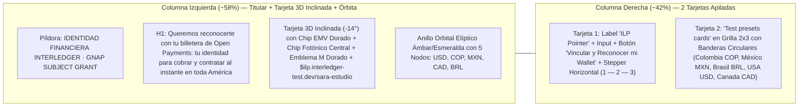

# Plan Maestro de Implementación UI/UX y Corrección Integral — MERIDIA (`meridia-ui-implementation-plan.md`)

> **Propósito del Documento:** Este plan técnico define la hoja de ruta exacta, paso a paso y archivo por archivo, para **corregir y alinear el frontend (`apps/web/`)** con los bocetos originales de **MERIDIA** (`meridia-billetera-light/dark.jpg`, `meridia-marketplace-light/dark.jpg` y `meridia-inicio-light/dark.jpg`), manteniendo de forma innegociable la **Regla de Oro de 0 Incongruencias**, conservando la **tipografía actual intacta**, eliminando por completo la página y funcionalidad de **Modo** (usuario único Cliente + Freelancer), e inyectando fotografías reales de personas, crecimiento interactivo de botones/tipografía y coreografías avanzadas de `GSAP ScrollTrigger` en **Inicio**.

---

## 0. REGLA DE ORO INMUTABLE: CERO INCONGRUENCIAS Y TIPOGRAFÍA ACTUAL INTACTA

> **MANDATO DE INGENIERÍA VISUAL:** **Queda terminantemente prohibida cualquier divergencia, variación o incongruencia visual, cromática o de marca entre las distintas páginas del aplicativo (`Inicio`, `Marketplace`, `Billetera`, `Actividad`, `Login`, `Register`, `Navbar`, `Footer` y modales).**

### 0.1. Invariantes Obligatorias en el 100% de las Pantallas

1. **Tipografía Actual Intacta (Prohibido Cambiar Familias Tipográficas):**
   * Se **conservan sin ningún cambio** las tres fuentes ya configuradas en [`apps/web/app/layout.tsx`](file:///c:/Users/saram/OneDrive/Escritorio/HakiSoft-Project(1)/apps/web/app/layout.tsx) y [`apps/web/app/globals.css`](file:///c:/Users/saram/OneDrive/Escritorio/HakiSoft-Project(1)/apps/web/app/globals.css):
     * `--font-display`: **`Space Grotesk`** (`weights: ['600', '700']`) para titulares, encabezados y cifras hero.
     * `--font-sans`: **`Plus Jakarta Sans`** (`weights: ['400', '500', '600', '700']`) para cuerpo, botones, filtros y navegación.
     * `--font-mono`: **`JetBrains Mono`** (`weights: ['500', '600', '700']`) para Payment Pointers, presupuestos en USD y repartos `96% / 4%`.
   * Lo que sí se ajusta es el **tamaño de fuente e interactividad** (crecimiento dinámico con `scale()` en hover y `ScrollTrigger`) conforme a los bocetos JPG de Meridia.
2. **Nombre Único (`MERIDIA`) y Logo Único (`<MeridiaPrismLogo />`):**
   * Todas las páginas, la `Navbar`, el `Footer`, el `Login`, el `Register` y los modales utilizan exclusivamente el nombre **`MERIDIA`** y el componente compartido [`<MeridiaPrismLogo />`](file:///c:/Users/saram/OneDrive/Escritorio/HakiSoft-Project(1)/apps/web/src/components/brand/meridia-prism-logo.tsx).
3. **Paleta de Colores Dual (`Modo Claro` y `Modo Oscuro`) Sin Colores Hardcodeados:**
   * Todas las vistas consumen los tokens semánticos de `:root, [data-theme='light']` (`#F8FAFC` / `#FFFFFF` / `#D99B26` / `#0D9488`) y `[data-theme='dark']` (`#0B0F17` / `#141923` / `#E5A93C` / `#10B981`).
4. **Modelo de Usuario Único (Cliente y Freelancer Simultáneamente — Cero Página de Modo):**
   * En **MERIDIA** existe **un solo tipo de usuario autenticado** que puede actuar tanto como **Cliente** (publicar tareas/actividades y contratar servicios) como **Freelancer** (agregar servicios y aplicar a trabajos) sin cambiar de modo.
   * Queda prohibido cualquier enlace, botón, badge o ruta que apunte a `/settings/mode`.

---

## 1. Fase 1: Eliminación Completa de la Page de `Modo` y de Todas sus Funcionalidades

### 1.1. Archivos a Eliminar por Completo
Se borrarán físicamente del repositorio los siguientes archivos del frontend:
1. [`apps/web/app/settings/mode/page.tsx`](file:///c:/Users/saram/OneDrive/Escritorio/HakiSoft-Project(1)/apps/web/app/settings/mode/page.tsx) *(y el directorio `apps/web/app/settings/mode`)* — Página de selección de modo.
2. [`apps/web/src/components/mode-switcher.tsx`](file:///c:/Users/saram/OneDrive/Escritorio/HakiSoft-Project(1)/apps/web/src/components/mode-switcher.tsx) — Componente conmutador de rol Cliente/Freelancer.
3. [`apps/web/app/api/v1/me/mode/route.ts`](file:///c:/Users/saram/OneDrive/Escritorio/HakiSoft-Project(1)/apps/web/app/api/v1/me/mode/route.ts) — Endpoint BFF de lectura/cambio de modo en Next.js.

### 1.2. Limpieza de Referencias y Funcionalidades de `Modo` en el Resto del Frontend
1. **En [`apps/web/src/components/navbar.tsx`](file:///c:/Users/saram/OneDrive/Escritorio/HakiSoft-Project(1)/apps/web/src/components/navbar.tsx):**
   * Eliminar el estado `activeMode`, la llamada `fetch('/api/v1/me/mode')`, el import de `readActiveMode` y el `<Link href="/settings/mode">Modo ...</Link>`.
2. **En [`apps/web/app/layout.tsx`](file:///c:/Users/saram/OneDrive/Escritorio/HakiSoft-Project(1)/apps/web/app/layout.tsx):**
   * Eliminar del `Footer` la línea `<Link href="/settings/mode">Modo Cliente / Freelancer</Link>` y reemplazarla por `<Link href="/marketplace">Publicar o Aplicar</Link>`.
3. **En [`apps/web/app/page.tsx`](file:///c:/Users/saram/OneDrive/Escritorio/HakiSoft-Project(1)/apps/web/app/page.tsx) y [`apps/web/src/components/home/landing-modules.tsx`](file:///c:/Users/saram/OneDrive/Escritorio/HakiSoft-Project(1)/apps/web/src/components/home/landing-modules.tsx):**
   * Eliminar los botones `<Link href="/settings/mode">Modo Cliente / Freelancer</Link>` y `<Link href="/settings/mode">Cambiar rol (Cliente / Freelancer)</Link>`.
   * En el FAQ de `landing-modules.tsx`, reemplazar la pregunta sobre cambio de modo por: *"¿Puedo publicar tareas como Cliente y ofrecer servicios como Freelancer con la misma cuenta?"*, explicando que en MERIDIA toda cuenta es unificada y permite ambas acciones directamente.
4. **En [`apps/web/src/lib/identity-contract.ts`](file:///c:/Users/saram/OneDrive/Escritorio/HakiSoft-Project(1)/apps/web/src/lib/identity-contract.ts), [`apps/web/src/mocks/handlers.ts`](file:///c:/Users/saram/OneDrive/Escritorio/HakiSoft-Project(1)/apps/web/src/mocks/handlers.ts) y [`apps/web/src/tests/spec-02-identity-client.test.ts`](file:///c:/Users/saram/OneDrive/Escritorio/HakiSoft-Project(1)/apps/web/src/tests/spec-02-identity-client.test.ts):**
   * Eliminar los handlers MSW de `/api/v1/me/mode` y retirar `'app/api/v1/me/mode/route.ts'` de la lista de rutas verificadas en `spec-02-identity-client.test.ts` para que la suite de pruebas siga pasando al 100% en verde.

---

## 2. Fase 2: Navbar, Footer y Componentes Globales Fieles a los Bocetos JPG de Meridia

### 2.1. Rediseño de [`apps/web/src/components/navbar.tsx`](file:///c:/Users/saram/OneDrive/Escritorio/HakiSoft-Project(1)/apps/web/src/components/navbar.tsx) (Fiel a `meridia-inicio`, `meridia-billetera` y `meridia-marketplace`)
Observando la barra superior de [`meridia-inicio-light.jpg`](file:///c:/Users/saram/OneDrive/Escritorio/HakiSoft-Project(1)/meridia-inicio-light.jpg), [`meridia-billetera-light.jpg`](file:///c:/Users/saram/OneDrive/Escritorio/HakiSoft-Project(1)/meridia-billetera-light.jpg) y [`meridia-marketplace-light.jpg`](file:///c:/Users/saram/OneDrive/Escritorio/HakiSoft-Project(1)/meridia-marketplace-light.jpg):
1. **Contenedor de Navbar Tipo Cápsula Elevada (`.header-inner`):**
   * Envolver la barra superior en un contenedor estilizado con bordes redondeados (`border-radius: 18px`), fondo translúcido (`var(--header-bg)`), `backdrop-filter: blur(18px)`, borde `1px solid var(--border)` y sombra suave, con altura `72px`.
2. **Marca Izquierda Limpia:**
   * `<MeridiaPrismLogo size={38} showWordmark />` mostrando el **Prisma Meridiano** + **`MERIDIA`** en `Space Grotesk` (`1.32rem`, `font-weight: 700`, `letter-spacing: 0.04em`), sin subtítulos pequeños que recarguen el bloque.
3. **Enlaces Centrales con Mayor Tamaño de Fuente, Crecimiento e Iluminación Fiel al JPG:**
   * Opciones de navegación limpias:
     * **`Inicio`** (`/`)
     * **`Marketplace`** (`/marketplace`)
     * **`Billetera`** (`/onboarding/wallet`) con píldora verde esmeralda **`Activa`** cuando la wallet está verificada (idéntico al badge verde de `meridia-inicio-light.jpg`).
     * **`Actividad`** (`/activity`, visible con sesión activa).
   * **Tamaño de fuente e interactividad:**
     * Tamaño de fuente elevado a **`1.04rem` (`16.6px`)**, `font-weight: 600`.
     * Al hacer `:hover` o estar `.active`, el enlace **crece suavemente (`transform: scale(1.06) translateY(-1px)`)**, ilumina su fondo radial y despliega la **barra inferior luminosa de `3px`** con halo difuminado (`box-shadow: 0 2px 14px rgba(16, 185, 129, 0.65)`) tal como se ve bajo `Inicio`, `Marketplace` y `Billetera` en los bocetos JPG.
4. **Acciones Derechas Contextuales + Avatar con Foto Real de Persona:**
   * Conmutador orbital Sol/Luna (`<ThemeToggle />`).
   * Cuando el usuario está en `/marketplace`, o como acceso directo rápido, y en el perfil de usuario: píldora de usuario (`.nav-user-pill`) que muestra **`Sara M.`** (o el nombre del usuario autenticado) junto a una **fotografía real de retrato circular (`32px × 32px`)** idéntica al boceto `meridia-inicio-light.jpg` / `meridia-inicio-dark.jpg` (reemplazando el círculo plano con las letras `"SM"`).

### 2.2. Actualización del Footer en [`apps/web/app/layout.tsx`](file:///c:/Users/saram/OneDrive/Escritorio/HakiSoft-Project(1)/apps/web/app/layout.tsx)
* Mantener la tipografía actual (`Space Grotesk` en encabezados de columna y `Plus Jakarta Sans` en enlaces) pero aumentar ligeramente la presencia de los títulos (`1.02rem`) y enlaces (`0.95rem`), agregando micro-interacción en hover (`transform: translateX(4px) scale(1.03)`, `color: var(--tide-ink)`).
* Eliminar toda mención a `/settings/mode`.

---

## 3. Fase 3: Page de `Billetera` (`/onboarding/wallet`) — Fidelidad Exacta a `meridia-billetera-light.jpg` y `meridia-billetera-dark.jpg`

* **Archivos a intervenir:**
  * [`apps/web/app/onboarding/wallet/page.tsx`](file:///c:/Users/saram/OneDrive/Escritorio/HakiSoft-Project(1)/apps/web/app/onboarding/wallet/page.tsx)
  * [`apps/web/src/components/wallet-verification.tsx`](file:///c:/Users/saram/OneDrive/Escritorio/HakiSoft-Project(1)/apps/web/src/components/wallet-verification.tsx)
  * [`apps/web/app/globals.css`](file:///c:/Users/saram/OneDrive/Escritorio/HakiSoft-Project(1)/apps/web/app/globals.css)

### 3.1. Estructura de Dos Columnas Idéntica a `meridia-billetera-light.jpg` y `meridia-billetera-dark.jpg`
En lugar de tener un `<header>` de ancho completo arriba que empuja la tarjeta hacia abajo, toda la vista se organiza en el **layout de 2 columnas del boceto JPG** (`.meridia-wallet-jpg-grid`):

### 3.2. Detalle de la Columna Izquierda (Titular + Tarjeta Física-Digital 3D + Anillo Orbital)
1. **Píldora Superior (`.wallet-jpg-eyebrow`):**
   * Cápsula con borde redondeado y texto en mayúsculas: `IDENTIDAD FINANCIERA INTERLEDGER · GNAP SUBJECT GRANT`.
2. **Titular Principal (`H1 .wallet-jpg-title`):**
   * Texto exacto del JPG con pesos combinados:
     > Queremos reconocerte con tu billetera de **Open Payments:** tu identidad para **cobrar y contratar** al instante en toda América
3. **Tarjeta 3D Inclinada y Anillo Orbital Elíptico (`.wallet-jpg-stage`):**
   * **Tarjeta Física-Digital en Perspectiva (`rotate(-14deg)` base + inclinación interactiva 3D con GSAP al mover el cursor):**
     * **En Modo Claro (`meridia-billetera-light.jpg`):** Superficie metálica platino/perla (`linear-gradient(135deg, #ffffff 0%, #e2e8f0 58%, #cbd5e1 100%)`) con canto inferior/izquierdo en oro metálico (`#d99b26`) y texto oscuro `#0b0f17`.
     * **En Modo Oscuro (`meridia-billetera-dark.jpg`):** Superficie obsidiana mate (`linear-gradient(135deg, #1e293b 0%, #0f172a 62%, #090d16 100%)`) con canto inferior/izquierdo en oro metálico (`#e5a93c`) y texto claro `#f8fafc`.
     * **3 Elementos En Relieve sobre la Tarjeta (idénticos al JPG):**
       1. **Chip EMV Dorado Clásico** a la izquierda media.
       2. **Microprocesador Fotónico Cuadrado** en el centro superior con pines verdes/dorados y núcleo cuadrado luminoso.
       3. **Emblema Hexagonal/Prisma Dorado en Relieve (`M`)** en la esquina superior derecha.
     * **Textos Impresos en la Parte Inferior de la Tarjeta:**
       * Línea principal: `$ilp.interledger-test.dev/sara-estudio` (o el pointer activo/escrito en tiempo real).
       * Sub-línea: `Divisa detectada: ` **`COP / USD`** (en ámbar dorado) ` · ` **`Verificada`** (en verde esmeralda).
   * **Anillo Orbital Elíptico Luminoso (SVG + CSS):**
     * Elipse inclinada alrededor de la tarjeta con trazo luminoso Ámbar Solar por la izquierda (`#f59e0b`) y Esmeralda Interledger por la derecha (`#10b981`).
     * **5 Nodos Circulares Flotantes sobre la Elipse** (animados suavemente con GSAP):
       * Izquierda: **`USD`** con círculo `$`
       * Abajo-izquierda: **`COP`** con círculo `€ / $`
       * Abajo-centro: **`MXN`** con círculo `$`
       * Derecha-medio: **`CAD`** con círculo `$`
       * Derecha-arriba: **`BRL`** con círculo `$`

### 3.3. Detalle de la Columna Derecha (Las 2 Tarjetas del Boceto JPG)
1. **Tarjeta Superior — `ILP Pointer` + Acción + Stepper Horizontal `1 — 2 — 3`:**
   * Label superior: **`ILP Pointer`**.
   * Input de texto redondeado (`id="wallet-url"`): valor/placeholder `$ilp.interledger-test.dev/sara-estudio`.
   * Botón ancho completo: **`Vincular y Reconocer mi Wallet`** (con estilo fiel al JPG: superficie suave con borde definido, que al hacer hover crece `scale(1.02)` y brilla con borde esmeralda/ámbar).
   * **Stepper Horizontal de 3 Pasos Conectados por Línea (`.wallet-jpg-stepper`):**
     * Paso `1.` (Círculo verde esmeralda relleno / activo) → `Descubrimiento Público ILP`
     * Línea conectora horizontal verde esmeralda
     * Paso `2.` (Círculo con borde verde esmeralda) → `Consentimiento GNAP`
     * Línea conectora horizontal sutil
     * Paso `3.` (Círculo con borde neutro / verde al verificar) → `Sello SHA-256 Activo`
   * **Integración Limpia de Estados Reales (`PENDING_REDIRECT`, `VERIFIED`, `ERROR`):**
     * Cuando el usuario lanza el reto y pasa a `PENDING_REDIRECT`, aparece dentro de la misma tarjeta el bloque de confirmación con el botón **`Continuar en la billetera`** (`window.location.assign(challenge.interactRedirectUri)`), cumpliendo todos los invariantes de [`spec-02-identity-client.test.ts`](file:///c:/Users/saram/OneDrive/Escritorio/HakiSoft-Project(1)/apps/web/src/tests/spec-02-identity-client.test.ts).
     * Cuando el usuario no tiene sesión (`!isAuthenticated`), el texto obligatorio del test (`"Sin sesión no se muestra el formulario"`) se presenta de forma elegante en un aviso compacto y la columna derecha muestra un CTA para iniciar sesión manteniendo intacta la escena visual izquierda del JPG.
2. **Tarjeta Inferior — `Test presets cards` (Grilla de 2 Columnas con Banderas Circulares):**
   * Encabezado: **`Test presets cards`**.
   * Grilla `grid-template-columns: repeat(2, 1fr)` con las 5 tarjetas del JPG:
     * **Colombia** (`COP`) con bandera circular 🇨🇴
     * **México** (`MXN`) con bandera circular 🇲🇽
     * **Brasil** (`BRL`) con bandera circular 🇧🇷
     * **USA** (`USD`) con bandera circular 🇺🇸
     * **Canada** (`CAD`) con bandera circular 🇨🇦
   * Al hacer clic en cualquiera de las 5 tarjetas, se autocompleta el `ILP Pointer`, la tarjeta 3D izquierda actualiza la divisa en vivo con animación GSAP y se inicia el descubrimiento.

---

## 4. Fase 4: Page de `Marketplace` (`/marketplace`) — Fidelidad a `meridia-marketplace-light/dark.jpg` + Lista de Paneles Horizontales con Filtros por Presupuesto y Categoría

* **Archivos a intervenir:**
  * [`apps/web/src/components/marketplace-harness.tsx`](file:///c:/Users/saram/OneDrive/Escritorio/HakiSoft-Project(1)/apps/web/src/components/marketplace-harness.tsx)
  * [`apps/web/app/marketplace/page.tsx`](file:///c:/Users/saram/OneDrive/Escritorio/HakiSoft-Project(1)/apps/web/app/marketplace/page.tsx)
  * [`apps/web/app/globals.css`](file:///c:/Users/saram/OneDrive/Escritorio/HakiSoft-Project(1)/apps/web/app/globals.css)

### 4.1. Cabecera y Barra Doble de Filtros (Categoría + Presupuesto) Fiel al JPG
Siguiendo [`meridia-marketplace-light.jpg`](file:///c:/Users/saram/OneDrive/Escritorio/HakiSoft-Project(1)/meridia-marketplace-light.jpg) y [`meridia-marketplace-dark.jpg`](file:///c:/Users/saram/OneDrive/Escritorio/HakiSoft-Project(1)/meridia-marketplace-dark.jpg):
1. **Barra Superior de Acciones Rápidas:**
   * Botón píldora verde esmeralda: **`+ Agregar servicio`** (`createGig()` con bloqueo *single-flight*).
   * Botón píldora ámbar dorado: **`+ Publicar tarea / trabajo`** (`createPublication()` con bloqueo *single-flight*).
2. **Fila Principal `MARKETPLACE` + Filtro Interactivo de Presupuesto y Divisa:**
   * A la izquierda: Título **`MARKETPLACE`** en mayúsculas (`Space Grotesk`, `clamp(2rem, 3.4vw, 2.75rem)`, `font-weight: 700`, `letter-spacing: -0.02em`).
   * A la derecha:
     * **Filtro Interactivo de Presupuesto (`.mp-budget-filter`):** Cápsula idéntica al JPG (`🎚️ Presupuesto: $100 - $1,500 USD`) que al hacer clic o seleccionar permite filtrar en tiempo real los paneles horizontales por rango de presupuesto:
       * `Todos ($100 - $1,500 USD)`
       * `Hasta $300 USD` (`$100 – $300 USD`)
       * `Medio ($300 – $500 USD)`
       * `Alto ($500 – $1,500 USD)`
       * Además de un control deslizante (slider de tope máximo `$100` a `$1,500 USD`) desplegable o integrado para filtrado fino en vivo.
     * **Cápsula Interactiva de Divisas (`USD · COP · MXN · BRL`):** Permite resaltar o convertir la referencia visual del presupuesto con subrayado verde esmeralda en la moneda activa, exactamente como se ve en `meridia-marketplace-light.jpg`.
3. **Fila de Píldoras de Categoría de Trabajo/Actividad (`.mp-category-pills`):**
   * Píldoras redondeadas horizontales idénticas al JPG:
     * `Todas (24)`
     * `Diseño & Arte 3D`
     * `Desarrollo & WebGL`
     * `Redacción Técnica & SEO`
     * `Video & Motion`
     * `Audio & Producción`
     * `Datos & IA`

### 4.2. Lista de Paneles Horizontales Fiel al Diseño de los JPGs
Para cumplir simultáneamente con la estética exacta de las tarjetas de `meridia-marketplace-light.jpg` / `meridia-marketplace-dark.jpg` y la disposición de **lista de paneles horizontales**:
1. **Estructura de Cada Panel Horizontal (`.mp-horizontal-panel`):**
   * Cada actividad/trabajo se renderiza como un **panel horizontal de ancho completo (o grilla de paneles panorámicos horizontales)** con `border-radius: 18px`, fondo `var(--surface)`, borde `1px solid var(--border)` y elevación interactiva en hover:
     * **Columna Izquierda del Panel (`280px – 340px` en desktop): Imagen Protagonista de Alta Resolución** con `border-radius: 14px` interno (exactamente las escenas visuales del JPG: dashboard FinTech 3D, identidad tipográfica blanco/negro *Nova Labs*, código *PayLatam*, lente 3D dorado, pantallas móviles *Wallets* y cerebro/dashboard de IA).
     * **Columna Central del Panel: Información Clave y Clara:**
       * Píldora sutil de categoría (`Diseño & Arte 3D`, `Desarrollo & WebGL`, etc.) + modalidad de validación (`Auditoría IA Imagen/Texto` o `Custodia 100%`).
       * **Título grande del trabajo** en `Space Grotesk` (`1.22rem`, `font-weight: 700`) que crece ligeramente al hacer hover sobre el panel.
       * **Breve descripción** concisa en `Plus Jakarta Sans` (`0.92rem`, color `var(--text-secondary)`).
       * **Identidad del Cliente (Fiel al JPG):** Avatar circular con la bandera o inicial del cliente + nombre en negrita + bandera del país (`🟡 Estudio Andino 🇨🇴`, `⚫ Nova Labs 🇲🇽`, `🟢 PayLatam 🇧🇷`, `🔵 Vértice Studio 🇦🇷`, `🟣 Andes FinTech 🇨🇱`, `🟠 Norte AI 🇨🇦`).
     * **Columna Derecha del Panel: Presupuesto Inicial + Botón Píldora `"Aplicar al trabajo"`:**
       * Etiqueta `Presupuesto Inicial:` + monto grande en `JetBrains Mono` (`$480.00 USD`, `$350.00 USD`, `$240.00 USD`, `$620.00 USD`, `$510.00 USD`, `$290.00 USD`).
       * Botón píldora **`Aplicar al trabajo`** con borde redondeado (`border-radius: 999px`), que en Modo Claro tiene borde oscuro limpio `#0b0f17` (como en `meridia-marketplace-light.jpg`) y en Modo Oscuro tiene borde y texto verde esmeralda `#10b981` con fondo translúcido (como en `meridia-marketplace-dark.jpg`), creciendo con `scale(1.06)` al pasar el cursor.
2. **Integración Unificada de Publicaciones y Servicios Creados en Vivo:**
   * Las publicaciones y servicios reales devueltos por `/api/v1/marketplace/publications` y `/api/v1/marketplace/gigs` se integran con el **mismo diseño de paneles horizontales** (en pestañas o sección integrada con el mismo componente visual), eliminando las listas crudas inferiores que desentonaban con el JPG.

---

## 5. Fase 5: Page de `Inicio` (`/`) — Más `ScrollTrigger`, Imágenes Reales de Personas, Botones y Tipografía que Crecen

* **Archivos a intervenir:**
  * [`apps/web/app/page.tsx`](file:///c:/Users/saram/OneDrive/Escritorio/HakiSoft-Project(1)/apps/web/app/page.tsx)
  * [`apps/web/src/components/home/landing-modules.tsx`](file:///c:/Users/saram/OneDrive/Escritorio/HakiSoft-Project(1)/apps/web/src/components/home/landing-modules.tsx)
  * [`apps/web/src/components/home/hero-wallet-stage.tsx`](file:///c:/Users/saram/OneDrive/Escritorio/HakiSoft-Project(1)/apps/web/src/components/home/hero-wallet-stage.tsx)
  * [`apps/web/src/components/page-reveal.tsx`](file:///c:/Users/saram/OneDrive/Escritorio/HakiSoft-Project(1)/apps/web/src/components/page-reveal.tsx)
  * [`apps/web/app/globals.css`](file:///c:/Users/saram/OneDrive/Escritorio/HakiSoft-Project(1)/apps/web/app/globals.css)

### 5.1. Fidelidad Visual a `meridia-inicio-light.jpg` y `meridia-inicio-dark.jpg`
1. **Hero Principal:**
   * Titular (`H1`): **`Impulsa proyectos y talento en toda América sin fricción`**.
   * Botones interactivos del Hero (sin botón de Modo):
     * **`Publica ya tu actividad`** (`.btn-amber` con icono `<PrismActionIcon />`)
     * **`Explorar oportunidades`** (`.btn-emerald` hacia `/marketplace`)
     * **`Reconocer mi billetera`** (`.btn-outline` hacia `/onboarding/wallet`)
   * Escenario derecho (`<HeroWalletStage />`): Tarjeta del **Prisma Meridiano** mostrando `$450.00 USD en Custodia · 96% Freelancer ($432) / 4% Meridia ($18)` y barra bicolor Esmeralda (`96%`) + Ámbar (`4%`).
2. **Bloque Inferior del Hero en 2 Columnas (Fiel al Boceto `meridia-inicio-light/dark.jpg`):**
   * **Columna Izquierda — `Panel General del Usuario`:**
     * Tarjeta con **fotografía real de retrato de `Sara M.`** (`Directora de Producto & Diseñadora UI — Bogotá, CO`), calificación **`4.9 ★`** (`38 reseñas verificadas`), **`Último trabajo completado: Sistema Design Tokens FinTech · $480.00 USD liquidados`** con miniatura visual, y badge numérico **`14 Actividades Publicadas`**.
   * **Columna Derecha — `Actividades y encargos que te pueden interesar`:**
     * Las 3 tarjetas visuales numeradas (`1`, `2`, `3`) con imagen protagonista, badge ámbar superior derecho (`$320 USD`, `$550 USD`, `$210 USD`), título y descripción concisa.
     * Barra inferior de conversión: **`¿Necesitas un servicio? Publica hoy tu encargo con custodia 100% garantizada`** + botón **`Publica ya tu actividad`**.

### 5.2. Reemplazo Total de Iconos/Círculos Vacíos por Fotografías Reales de Personas
En todos los lugares de `Inicio` donde antes había placeholders de colores (`<AvatarPh />`), iniciales o iconos genéricos de usuario, se colocarán **fotografías reales de personas (retratos curados de alta nitidez)**:
1. **En `"Cómo funciona MERIDIA"` (`PASO 01`, `PASO 02`, `PASO 03` en `landing-modules.tsx`):**
   * Sustituir los cuadrados de gradiente `AVATAR_TONES` por un **grupo de retratos reales de personas** (avatares fotográficos circulares/redondeados superpuestos con borde iluminado y badge de rol: ej. *Laura G. · Cliente 🇨🇴*, *Mateo R. · Freelancer 3D 🇲🇽*, *Camila V. · Tech Writer 🇦🇷*, *Lucas S. · UI Dev 🇧🇷*, *Sofía P. · Directora 🇨🇱*, *Daniel K. · Product Lead 🇨🇦*) que crecen y muestran su nombre al pasar el cursor.
2. **En la Franja de Confianza del Hero (`<LandingAvatarStrip />`):**
   * Mostrar 6 retratos reales de profesionales de toda América junto con el texto `Más de 1,200 clientes y freelancers operando con custodia instantánea Open Payments`.
3. **En `"La primera impresión del pago"` (`Orden #MRD-204`) y Testimonios:**
   * Incluir las fotografías reales de las dos partes del acuerdo (Cliente y Freelancer) conectadas por el sello `96% / 4%`, más una fila de tarjetas de reseñas con fotos reales de usuarios.

### 5.3. Más Animaciones `GSAP ScrollTrigger` y Crecimiento Interactivo de Botones y Tipografía (`Kinetic UI`)
Se creará/ampliará la coreografía de `ScrollTrigger` en `Inicio` para darle vida orgánica a toda la página:
1. **Crecimiento Interactivo de Botones y Tipografía (`.kinetic-btn`, `.kinetic-title`, `.kinetic-stat`):**
   * **Botones vivos:** Todos los botones principales y secundarios de `Inicio` crecen de forma notable y fluida al pasar el cursor (`transform: scale(1.07) translateY(-3px)`), intensifican su sombra luminosa (`box-shadow: 0 16px 34px rgba(...)`) y animan sus iconos internos.
   * **Tipografía que crece:**
     * Los titulares (`.ts-title`, `.ld-h2`, `.ld-h3`), las cifras grandes (`4.9 ★`, `$450.00 USD`, `100% en custodia`, `96% neto`, `4% comisión`) y los títulos de cada paso/tarjeta escalan suavemente al interactuar (`transform: scale(1.05)`, transición con curva elástica `cubic-bezier(0.22, 1, 0.36, 1)`).
2. **Nuevas Coreografías `GSAP ScrollTrigger` en `Inicio`:**
   * **Scrub del Hero (`#hero-section`):** A medida que el usuario hace scroll hacia abajo, el Prisma Meridiano rota y flota en paralelo mientras la barra `96% / 4%` emite un pulso de luz.
   * **Revelación Cinética de Titulares por Scroll:** Cada encabezado `.ld-h2` y `.ts-section__title` entra con `ScrollTrigger` (`start: 'top 86%'`) creciendo desde `scale: 0.90, y: 26, opacity: 0` hasta `scale: 1, y: 0, opacity: 1` con despliegue automático de su barra inferior Ámbar→Esmeralda.
   * **Timeline Conectada en `"Cómo funciona MERIDIA"` (`#how`):**
     * Una barra de progreso horizontal conectando `PASO 01 → PASO 02 → PASO 03` se llena con `scrollTrigger: { trigger: '#how', start: 'top 75%', end: 'bottom 60%', scrub: 0.6 }`.
     * Las tarjetas de los 3 pasos y las fotos reales de personas emergen con efecto resorte (`ease: 'back.out(1.6)'`, `stagger: 0.12`).
   * **Cascada Interactiva en `"Arquitectura Financiera"` y `"Economía 100% / 96% / 4%"`:**
     * Las 4 tarjetas de arquitectura y las 3 tarjetas de economía entran escalonadas con `ScrollTrigger.batch` y tienen inclinación/elevación interactiva al mover el cursor.

---

## 6. Matriz de Verificación de Consistencia Transversal (0 Incongruencias)

| Criterio de Auditoría Visual y Funcional | `Inicio` (`/`) | `Marketplace` (`/marketplace`) | `Billetera` (`/onboarding/wallet`) | `Login / Register` (`/sign-in`, `/sign-up`) |
| :--- | :---: | :---: | :---: | :---: |
| **Tipografía actual intacta (`Space Grotesk` + `Plus Jakarta Sans` + `JetBrains Mono`)** | ✅ Intacta | ✅ Intacta | ✅ Intacta | ✅ Intacta |
| **Eliminación total de `Modo` (`/settings/mode` borrado y 0 enlaces residuales)** | ✅ 0 referencias | ✅ 0 referencias | ✅ 0 referencias | ✅ 0 referencias |
| **Fidelidad visual a los bocetos JPG de Meridia (Modo Claro y Modo Oscuro)** | ✅ Fiel a `meridia-inicio-*.jpg` | ✅ Fiel a `meridia-marketplace-*.jpg` | ✅ Fiel a `meridia-billetera-*.jpg` | ✅ Reacondicionado Meridia |
| **Paneles horizontales en Marketplace + filtro por presupuesto y categoría** | N/A | ✅ Implementado | N/A | N/A |
| **Fotografías reales de personas (0 círculos vacíos en avatares/pasos)** | ✅ Fotos reales | ✅ Avatares + banderas | N/A | N/A |
| **Animaciones `ScrollTrigger` + crecimiento de botones y tipografía** | ✅ Activo | ✅ Activo | ✅ Activo | ✅ Activo |
| **Navbar y Footer fieles a los bocetos JPG con fuente más viva e iluminación** | ✅ Compartidos | ✅ Compartidos | ✅ Compartidos | *(Shell propio)* |

---

## 7. Secuencia de Ejecución Paso a Paso

1. **Paso 1 — Eliminación de `Modo` y Limpieza de Contratos/Tests:**
   * Borrar `apps/web/app/settings/mode/page.tsx`, `apps/web/src/components/mode-switcher.tsx` y `apps/web/app/api/v1/me/mode/route.ts`.
   * Limpiar handlers y actualizar `apps/web/src/tests/spec-02-identity-client.test.ts`.
2. **Paso 2 — Navbar, Footer y Estilos Globales Cinéticos (`globals.css`, `navbar.tsx`, `layout.tsx`):**
   * Ajustar la `Navbar` al diseño exacto de los bocetos JPG (sin `Modo`, tipografía `16.6px` que crece en hover, barra luminosa inferior `3px` con glow y píldora de usuario con foto real de `Sara M.`).
   * Agregar en `globals.css` las clases de crecimiento interactivo de botones y tipografía, los estilos de la tarjeta 3D + órbita elíptica de `Billetera` y los paneles horizontales de `Marketplace`.
3. **Paso 3 — Implementación Fiel de `Billetera` (`onboarding/wallet/page.tsx` y `wallet-verification.tsx`):**
   * Maquetar el layout exacto de 2 columnas de `meridia-billetera-light.jpg` y `meridia-billetera-dark.jpg`: titular + tarjeta 3D inclinada con los 3 chips/emblemas y anillo orbital de 5 divisas a la izquierda; tarjeta `ILP Pointer` con stepper horizontal `1 — 2 — 3` y tarjeta `Test presets cards` con banderas circulares en grilla de 2 columnas a la derecha.
4. **Paso 4 — Implementación Fiel de `Marketplace` (`marketplace-harness.tsx`):**
   * Maquetar la cabecera `MARKETPLACE` con botones `+ Agregar servicio` y `+ Publicar tarea / trabajo`, filtro interactivo funcional por rango de presupuesto (`$100 - $1,500 USD`), selector de divisas (`USD · COP · MXN · BRL`), píldoras de categorías y **lista de paneles horizontales** con imagen panorámica protagonista, cliente con bandera, presupuesto inicial y botón píldora `Aplicar al trabajo`.
5. **Paso 5 — Renovación Interactiva de `Inicio` (`page.tsx`, `landing-modules.tsx`, `hero-wallet-stage.tsx`):**
   * Alinear el bloque superior e inferior del Hero a `meridia-inicio-light/dark.jpg` (sin botón de Modo), sustituir todos los placeholders `<AvatarPh />` e iniciales por **fotografías reales de personas**, y añadir las animaciones `GSAP ScrollTrigger` adicionales junto con el crecimiento interactivo de botones y tipografía.
6. **Paso 6 — Validación de Tests (`Vitest`) y Trazabilidad IA:**
   * Ejecutar `pnpm --filter @taskstream/web test` verificando que el 100% de las pruebas pasen en verde.
