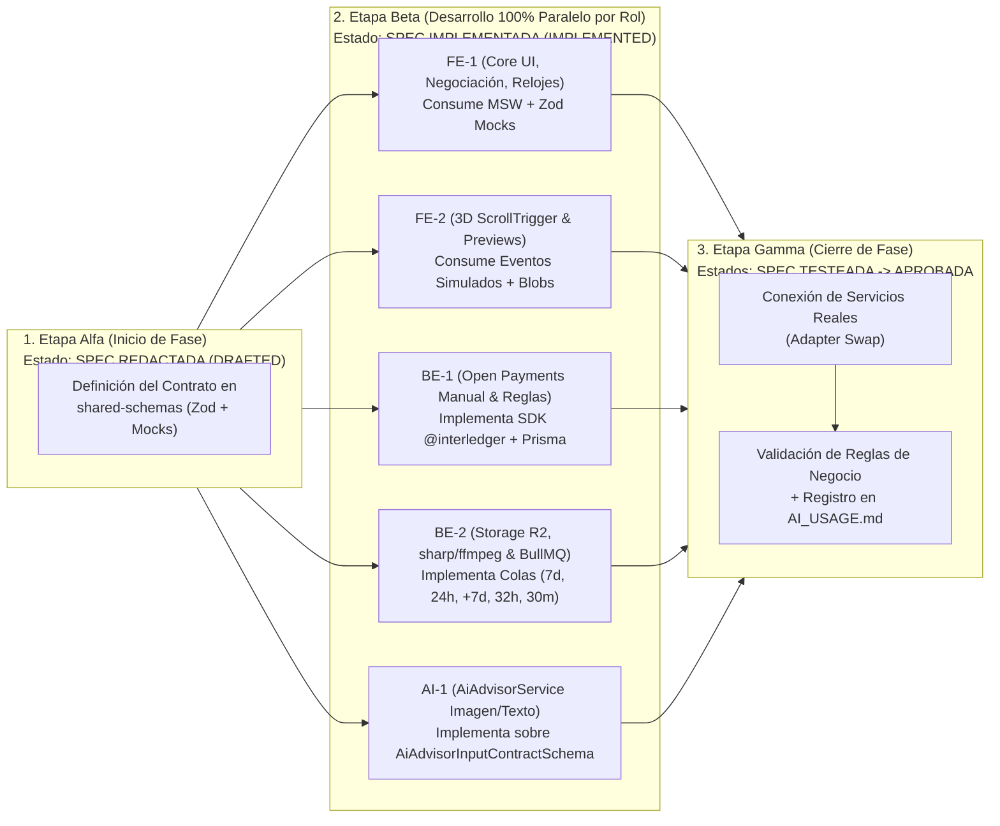

# Plan de Desarrollo Fase por Fase (Phase-by-Phase Development) — TaskStream AI (`pbp-development.md`)

> **Documento Oficial de Ejecución por Fases (`pbp-development.md`):** Define la hoja de ruta paso a paso de **TaskStream AI**, el ciclo de redacción y aprobación de cada especificación (desde `SPEC-00.md` para la creación de la carpeta `specs` y su `README.md`, hasta `SPEC-12.md` para el `Deploy`) y el **Protocolo de Ingeniería Paralela Sin Bloqueos** para los **5 desarrolladores (`2 Frontend: FE-1, FE-2 / 2 Backend: BE-1, BE-2 / 1 IA: AI-1`)**.
>
> 🔗 **Alineado con:** `CONTEXT.md`, `architecture-overview.md`, `taskboard.md`, `sdd-process.md` y `AI_USAGE.md`.

---

## 1. Protocolo de Ingeniería Paralela Sin Bloqueos para los 5 Desarrolladores

El principio rector de ejecución en **TaskStream AI** es que **ninguna función del Backend (`BE-1`, `BE-2`) imposibilite o frene jamás el desarrollo del equipo de Frontend (`FE-1`, `FE-2`) o del equipo de IA (`AI-1`)**.

### 1.1. Estructura de Ejecución en 3 Etapas por Fase

### 1.2. Mecanismo de Independencia por Rol

| Rol | ¿Cómo avanza al 100 % sin depender de que otro equipo termine primero? |
| :---- | :---- |
| **`FE-1`** *(Core UI, Marketplace, Negociación, Plazos y Disputas)* | Consume el cliente HTTP tipado con **MSW (Mock Service Worker)** alimentado por `shared-schemas`. Puede simular desde el primer día los estados de la orden (`ESCROW_LOCKED`, `EXTENSION_REQUESTED`, `ESCROW_EXTENDED`, `IN_REVIEW`, `FINAL_CLAIM_WINDOW_30M`, `DISPUTED`, `COMPLETED`, `REFUNDED`). |
| **`FE-2`** *(Escenas 3D `GSAP ScrollTrigger` + `Lenis` y Visores `Protected Preview`)* | Construye las escenas en `@react-three/fiber v9` y los 6 visores protegidos escuchando eventos de estado desacoplados y utilizando archivos de muestra con marca de agua locales sin esperar a Cloudflare R2. |
| **`BE-1`** *(Pagos Open Payments Manual, Negociación y Arbitraje)* | Programa y verifica `open-payments.service.ts` y `escrow-payment.service.ts` (con intervención de IA mínima o nula) directamente mediante pruebas de integración y llamadas al entorno de Interledger Test Wallet / Rafiki. |
| **`BE-2`** *(Modelo 3NF Prisma, Cloudflare R2, Marcas de Agua y Relojes BullMQ)* | Desarrolla los 5 relojes independientes en BullMQ (`7d`, `24h`, `+7d`, `32h`, `30m`) invocando la interfaz `IEscrowPaymentGateway` con relojes simulados antes de unir el servicio real de `BE-1`. |
| **`AI-1`** *(Contratos Globales y `AiAdvisorService` para Imagen y Texto)* | Define en `SPEC-08.md` el contrato exacto de entrada `AiAdvisorInputContractSchema` y desarrolla `AiAdvisorService` para tareas de **imagen y texto** usando *fixtures* locales sin depender de que el flujo de subida a R2 esté concluido. |

---

## 2. Desarrollo Fase por Fase (`SPEC-00` a `SPEC-12`)

---

### Fase 0: Creación de Estructura `specs/` (`SPEC-00`) y Contratos Fundacionales (`SPEC-01`)

#### A. Especificaciones de la Fase
* **`SPEC-00.md`:** Creación de la carpeta `specs` y su `README.md` con el índice maestro de especificaciones desde `SPEC-00` hasta `SPEC-12` (`Deploy`).
* **`SPEC-01.md`:** Definición de los contratos compartidos en `shared-schemas` y del modelo relacional de base de datos v2 (`schema.prisma` + `domain_checks.sql`), documentado en sus tres pasos en `architecture-overview.md` §5, con `TaskOrder` desacoplada.

#### B. Trabajo Paralelo por Rol
* **`AI-1`:** Crea la carpeta `specs` y su `README.md` (`SPEC-00.md`), e inicializa `shared-schemas` (`SPEC-01.md`) exportando los esquemas de órdenes, plazos, contrato de entrada/salida de IA y generadores de *mocks*.
* **`FE-1` + `FE-2`:** Inicializan la aplicación Frontend en Next.js 15.5 + React 19 y conectan MSW con `shared-schemas`.
* **`BE-1` + `BE-2`:** Inicializan la aplicación Backend en NestJS 10.4 + Prisma 6 + BullMQ.

#### C. Criterio de Aprobación de Fase
* La carpeta `specs` y su `README.md` están creados y el paquete `shared-schemas` compila y provee tipos y *mocks* a Frontend, Backend e IA.

---

### Fase 1: Identidad Multimoneda en América (`SPEC-02`) y Motor 3D Scroll-Driven (`SPEC-03`)

#### A. Especificaciones de la Fase
* **`SPEC-02.md`:** Autenticación con Clerk y verificación criptográfica de posesión de billetera multimoneda en América mediante Open Payments (`Subject Grant` + verificación de hash).
* **`SPEC-03.md`:** Configuración de `Lenis` + `GSAP ScrollTrigger` + `@react-three/fiber v9` + `@react-three/drei v10` aislados en cliente a 60–120 FPS sin re-renders de React.

#### B. Trabajo Paralelo por Rol
* **`FE-1`:** Construye el inicio de sesión, el selector `Buyer Mode / Seller Mode` y la pantalla de vinculación de `walletAddress` americana sobre mocks de `SPEC-02.md`.
* **`FE-2`:** Construye el proveedor de Smooth Scroll y la escena 3D principal controlada por `ScrollTrigger` (`SPEC-03.md`).
* **`BE-1` (`🛡️ Autoría Manual`):** Configura las claves `Ed25519` e implementa en `open-payments.service.ts` el descubrimiento con `UnauthenticatedClient` y la verificación `Subject Grant`.
* **`BE-2`:** Ejecuta la migración del modelo 3NF en PostgreSQL con las restricciones `CHECK` SQL y el webhook de usuarios de Clerk.
* **`AI-1`:** Implementa las pruebas automatizadas de validación sobre los esquemas de `SPEC-01.md` y `SPEC-02.md`.

#### C. Criterio de Aprobación de Fase
* `SPEC-02.md` y `SPEC-03.md` alcanzan el estado `Aprobada` con usuarios verificando sus billeteras multimoneda y navegando por la escena 3D con `ScrollTrigger`.

---

### Fase 2: Marketplace de 6 Categorías (`SPEC-04`) y Motor de Negociación (`SPEC-05`)

#### A. Especificaciones de la Fase
* **`SPEC-04.md`:** Catálogo de las 6 categorías del MVP, paquetes de servicios (*Gigs*), etiqueta Web Monetization y tablón de tareas publicadas por Buyers con presupuesto inicial y plazo inicial de hasta 7 días.
* **`SPEC-05.md`:** Bandeja de ofertas sobre publicaciones (`proposedBudget <= initialBudget`), selección de una oferta por el Buyer, discriminación respecto al **Gig a precio fijo no negociable**, y arranque solo tras **aceptación mutua + fondeo**.

#### B. Trabajo Paralelo por Rol
* **`FE-1`:** Catálogo, Gigs a precio fijo, formulario de publicación con tope, bandeja de ofertas (lista + perfiles) y aceptación/cancelación previa al escrow.
* **`FE-2`:** Animaciones `ScrollTrigger` para categorías y transición al cerrar un acuerdo.
* **`BE-1`:** Módulo de ofertas/aceptación mutua (ACID): elegir una oferta, descartar el resto, cancelar publicación antes de aceptar.
* **`BE-2`:** Marketplace, filtros e indexación.
* **`AI-1`:** Validación de criterios de aceptación y modalidad auditable (imagen/texto) cuando aplique.

#### C. Criterio de Aprobación de Fase
* `SPEC-04.md` y `SPEC-05.md` quedan `Aprobadas` tras verificar Gig fijo, bandeja de ofertas `<= tope` y arranque solo con aceptación mutua.

---

### Fase 3: Orquestación de Pago Único en Escrow (`96 % / 4 %` y Reembolsos `100 %`) (`SPEC-06`)

#### A. Especificaciones de la Fase
* **`SPEC-06.md`:** Depósito del 100 % en `taskstream-escrow`, liberación **96 % Freelancer + 4 % wallet del dueño** (dos `OutgoingPayment`), reembolsos **100 %** (actividad muere) e idempotencia.

#### B. Trabajo Paralelo por Rol
* **`BE-1` (`🛡️ Autoría Manual — Uso de IA Mínimo/Nulo`):** `escrow-payment.service.ts` con fondeo (`receiveAmount`), payout dual 96/4 a wallets distintas, reembolsos 100 %, grants y rotación de tokens.
* **`BE-2`:** Idempotencia `SHA-256`, `EscrowLedger` con FK a las wallets de las partes y a `PlatformWallet` (custodia y fee del dueño), una fila de `OpenPaymentsTransaction` por intento de cada pierna, webhooks Rafiki.
* **`FE-1`:** Checkout mostrando 96 % / 4 % (wallet dueño) e inicio de **7 días** tras fondeo.
* **`FE-2`:** Escena 3D de bóveda escrow.
* **`AI-1`:** Invariantes `100 % = 96 % + 4 %` e idempotencia.

#### C. Criterio de Aprobación de Fase
* `SPEC-06.md` queda `Aprobada` con depósito real, payout dual verificado y start del plazo de 7 días.

---

### Fase 4: Almacenamiento R2, *Protected Preview* (`SPEC-07`) y Consejero IA para Imagen y Texto (`SPEC-08`)

#### A. Especificaciones de la Fase
* **`SPEC-07.md`:** Subida directa a Cloudflare R2 sin límite de peso en el MVP (`/originals`), resguardo privado durante la revisión y generación de vistas previas con marca de agua (`/previews`).
* **`SPEC-08.md`:** Definición clara del **contrato exacto de entrada (`AiAdvisorInputContractSchema`)** que recibe `AiAdvisorService` y de su salida (`AiAdvisorReportSchema`), acotando la auditoría y asesoría de IA en el MVP **exclusivamente a tareas de imagen y texto** (dejando el resto de formatos y la suscripción planteados para Post-MVP).

#### B. Trabajo Paralelo por Rol
* **`AI-1`:** Concreta en `SPEC-08.md` el esquema `AiAdvisorInputContractSchema` e implementa `AiAdvisorService` para evaluar únicamente entregas de **imagen y texto** frente a los criterios de la orden, con pre-validación determinista y protección anti-*Prompt Injection*.
* **`BE-2`:** Implementa las Presigned URLs en Cloudflare R2 y los procesadores `sharp` y `fluent-ffmpeg` para generar el *Protected Preview*.
* **`FE-2`:** Construye los 6 visores del módulo *Protected Preview* para que el Buyer revise las entregas sin exponer el archivo original.
* **`FE-1`:** Construye el panel de subida del Freelancer y la vista de revisión del Buyer (integrando el visor protegido y mostrando el informe consultivo de IA cuando la tarea es de **imagen o texto**).
* **`BE-1`:** Implementa los Guards de acceso para que `/originals` permanezca bloqueado hasta que la entrega sea aceptada expresa o automáticamente.

#### C. Criterio de Aprobación de Fase
* `SPEC-07.md` y `SPEC-08.md` quedan `Aprobadas`: las entregas generan su vista protegida y, cuando son de **imagen o texto**, `AiAdvisorService` recibe `AiAdvisorInputContractSchema` y emite `AiAdvisorReportSchema`.

---

### Fase 5: Relojes (`7d`, `24h`, `+7d`, `32h`, `30m`), Correcciones (`SPEC-09`), Disputas (`SPEC-10`), Validación E2E (`SPEC-11`) y Deploy (`SPEC-12`)

#### A. Especificaciones de la Fase
* **`SPEC-09.md`:** Relojes independientes:
  * **7 días** iniciales; si vencen **sin** pedir extensión → `AUTO_REFUNDED_INITIAL_EXPIRED` (actividad muere).
  * Extensión **única solo al vencer** (+ hasta 7d); Buyer **24h**; silencio/rechazo/fallo de extensión → reembolso **100 %** (actividad muere).
  * **32h** revisión / máx. **2** correcciones; tras 2ª re-entrega: aceptar o pedir mediación.
  * **30m** sin petición de disputa → **96 % Freelancer + 4 % wallet dueño**.
* **`SPEC-10.md`:** Disputa por petición (post-2ª corrección o en 30m); fondos retenidos; decisión binaria Admin (**100 % Buyer** o **96 % / 4 % wallet dueño**).
* **`SPEC-11.md`:** Pruebas E2E.
* **`SPEC-12.md`:** Deploy final.

#### B. Trabajo Paralelo por Rol
* **`BE-2`:** Relojes BullMQ (`7d`, `24h`, `+7d solo al vencer`, `32h`, `30m`) y notificaciones.
* **`BE-1`:** Extensión solo al vencer, límite 2 correcciones + mediación, suspensión atómica en 30m, arbitraje conectado a escrow.
* **`FE-1`:** UI de extensión (24h), revisión 32h (`0/2`…`2/2`), ventana 30m, consola Admin.
* **`FE-2`:** Transiciones 3D con payout 96/4 (wallet dueño) y estados de reembolso/disputa.
* **`AI-1` + Todos:** Ejecutan la validación E2E completa (`SPEC-11.md`) y realizan el despliegue final a producción (`SPEC-12.md`), cerrando la trazabilidad en `AI_USAGE.md` y `promptsAI_USAGE.md`.

#### C. Criterio de Aprobación Final del Proyecto
* Todas las especificaciones desde `SPEC-00.md` hasta `SPEC-12.md` están en estado `Aprobada` y el MVP/Demo opera en producción cumpliendo íntegramente las reglas de negocio y la política de uso de IA.
