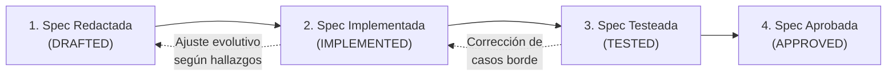

# Metodología de Desarrollo Guiado por Especificaciones (SDD) — TaskStream AI (`sdd-process.md`)

> **Propósito del Documento (`sdd-process.md`):** Describe de forma general cómo la metodología **SDD (Spec-Driven Development)** impacta directamente en la calidad y solidez del aplicativo final (**MVP / Demo** de **TaskStream AI**), cuáles son las funciones generales de las especificaciones dentro del proyecto, cómo se estructura su catálogo desde `SPEC-00` hasta la especificación final de despliegue y cómo se lleva a cabo el proceso general de desarrollo.

---

## 1. Impacto de SDD en el Aplicativo Final (MVP / Demo)

La adopción de **SDD** en **TaskStream AI** tiene como propósito garantizar un impacto directo, tangible y verificable sobre el **producto final entregado (MVP / Demo funcional)**:

1. **Exactitud Financiera y Cero Fugas en el Flujo de Custodia (Escrow):**
   * En el aplicativo final, cada centavo depositado por el Buyer en el escrow de TaskStream se comporta de manera determinista. Gracias a que las reglas financieras están especificadas como contratos estrictos, el MVP garantiza sin margen de error la retención del 100 % del pago, la liberación exacta del **96 % para el Freelancer y 4 % para TaskStream**, y el reembolso del **100 %** cuando corresponde por vencimientos o disputas.
2. **Sincronización Exacta de los Relojes y Reglas de Tiempo en Vivo:**
   * El usuario final experimenta un sistema predecible donde los plazos operan sin ambigüedades ni colisiones: **7 días** para la entrega inicial, **24 horas** para responder a una solicitud de extensión única de **hasta 7 días adicionales** (máximo 14 días en total), **32 horas** para revisar cada entrega (con un límite global de **2 correcciones** por orden) y **30 minutos** de ventana final de reclamaciones tras la aceptación expresa o automática antes de liberar los fondos.
3. **Coherencia Total entre la Interfaz Visual, el Visor Protegido y el Estado del Dinero:**
   * En la Demo, lo que el Buyer y el Freelancer ven en pantalla (animaciones 3D vinculadas al scroll, estado del escrow, bloqueo del archivo original durante la revisión y desbloqueo tras la aceptación) coincide siempre al 100 % con el estado real en la base de datos y en la red de pagos abiertos.
4. **Auditoría Consultiva de IA Acotada, Confiable y Predecible (Imagen y Texto en el MVP):**
   * Al exigir que el contrato de entrada y salida de `AiAdvisorService` esté formalmente definido antes de construir `AiAdvisorReportSchema`, el aplicativo final entrega informes consultivos claros, estructurados y libres de alucinaciones sobre entregas de **imagen y texto**, orientando al Buyer sin tomar jamás decisiones automáticas sobre el dinero.
5. **Estabilidad de Extremo a Extremo durante la Demostración en Vivo:**
   * El producto resultante carece de pantallas rotas, estados huérfanos o transiciones indefinidas (como reclamaciones durante la ventana final de 30 minutos o disputas tras agotar las 2 correcciones), asegurando un MVP robusto y auditable de principio a fin.

---

## 2. Funciones Generales de las Especificaciones y Cómo se Redactan

Las especificaciones no son tutoriales de código ni documentos estáticos aislados; cumplen **funciones generales de control y definición** a lo largo del proyecto:

### 2.1. Funciones Generales de una Especificación (`SPEC`)

1. **Delimitar el Alcance Funcional del Módulo:** Define qué hace exactamente una funcionalidad dentro del MVP y qué queda fuera de su alcance (por ejemplo, acotar la auditoría de IA del MVP exclusivamente a entregas de imagen y texto, dejando el resto de formatos y la suscripción planteados a futuro).
2. **Establecer los Contratos de Datos de Entrada y Salida:** Concreta las estructuras de datos exactas que reciben y devuelven los servicios (como el contrato exacto que debe recibir `AiAdvisorService` para poder generar `AiAdvisorReportSchema`).
3. **Fijar las Reglas de Negocio e Invariantes:** Documenta las condiciones obligatorias que el sistema debe hacer cumplir (límites de tiempo, porcentajes de distribución 96 % / 4 %, contadores globales de correcciones y restricciones de extensión única).
4. **Permitir el Avance Desacoplado entre Equipos:** Al definir las firmas de comunicación desde el inicio, permite que los equipos de Frontend, Backend e IA construyan sus componentes al mismo tiempo sin bloquearse mutuamente.
5. **Servir como Criterio de Verificación y Aprobación:** Establece el comportamiento esperado bajo escenarios de negocio claros para validar que la funcionalidad está lista antes de integrarse al cierre de cada fase.

### 2.2. Pautas Generales para Redactar las Especificaciones

Toda especificación dentro de la carpeta `specs` se redacta de forma concisa, clara y evolutiva contemplando los siguientes elementos generales:

* **Identificación y Estado Actual:** Código de la especificación, título descriptivo, fase a la que pertenece y estado dentro de su ciclo de vida (`Redactada`, `Implementada`, `Testeada` o `Aprobada`).
* **Objetivo y Reglas del Dominio:** Resumen del propósito funcional y listado de reglas innegociables alineadas con `CONTEXT.md` y `architecture-overview.md`.
* **Contratos Técnicos:** Definición de los esquemas de entrada, esquemas de salida, entidades involucradas en base de datos y puntos de comunicación entre capas.
* **Comportamiento Esperado y Casos de Borde:** Descripción de cómo responde el sistema ante el flujo normal y ante situaciones límite (vencimiento de plazos, falta de respuesta, rechazos o reclamaciones en la ventana de 30 minutos).
* **Criterios de Validación:** Condiciones verificables que confirman que la especificación fue cumplida en el aplicativo.

---

## 3. Catálogo General de Especificaciones del Proyecto (`SPEC-00` a `SPEC-12`)

El proyecto organiza sus especificaciones secuencialmente dentro de la carpeta `specs`, iniciando en `SPEC-00` (creación de la estructura documental de especificaciones) y finalizando en `SPEC-12` (despliegue del aplicativo):

| Especificación | Archivo | Función General dentro del Proyecto |
| :---- | :---- | :---- |
| **`SPEC-00`** | `SPEC-00.md` | **Creación de la carpeta `specs` y su `README.md`:** Establece la estructura del directorio de especificaciones, el índice general, la nomenclatura y las reglas de mantenimiento de los documentos SDD junto con la trazabilidad en `AI_USAGE.md` y `promptsAI_USAGE.md`. |
| **`SPEC-01`** | `SPEC-01.md` | **Contratos Globales y Modelo de Datos Limpio:** Define los esquemas compartidos del monorepo y el modelo relacional de base de datos normalizado (libre de entidades monolíticas), contemplando órdenes, escrow, plazos, entregas y disputas. |
| **`SPEC-02`** | `SPEC-02.md` | **Identidad y Verificación de Billeteras Multimoneda:** Define el inicio de sesión de usuarios y la validación criptográfica de posesión de billeteras en el continente americano mediante Open Payments. |
| **`SPEC-03`** | `SPEC-03.md` | **Arquitectura Visual 3D Vinculada al Scroll:** Define el funcionamiento general del motor de desplazamiento suave y las escenas 3D interactivas sincronizadas con los estados de la plataforma en el Frontend. |
| **`SPEC-04`** | `SPEC-04.md` | **Catálogo del Marketplace y Publicación de Tareas:** Define la estructura de las 6 categorías del MVP, la oferta de servicios de freelancers y la publicación de encargos por parte de los Buyers. |
| **`SPEC-05`** | `SPEC-05.md` | **Ofertas y Contratación:** Gig a precio fijo no negociable; publicaciones con tope y bandeja de ofertas `<=` máximo; arranque solo tras aceptación mutua + fondeo. |
| **`SPEC-06`** | `SPEC-06.md` | **Orquestación de Pagos y Escrow:** Depósito 100 %, liberación **96 % Freelancer + 4 % wallet del dueño**, reembolsos **100 %** (actividad muere) e idempotencia. |
| **`SPEC-07`** | `SPEC-07.md` | **Almacenamiento de Entregables y Previsualización Protegida:** Define la carga de archivos sin límite de peso en el MVP, el resguardo privado de los originales y la generación de vistas previas con marca de agua durante la etapa de revisión. |
| **`SPEC-08`** | `SPEC-08.md` | **Contrato de `AiAdvisorService` y `AiAdvisorReportSchema` (Imagen y Texto):** Concreta con total claridad el **contrato exacto de entrada** que recibe `AiAdvisorService` (criterios de la orden, metadatos y artefacto entregable) y el **contrato de salida (`AiAdvisorReportSchema`)**, acotado en el MVP exclusivamente a auditar y asesorar tareas de **imagen y texto**. |
| **`SPEC-09`** | `SPEC-09.md` | **Relojes, Extensión Solo al Vencer y Revisiones:** **7d** inicial (sin extensión al vencer → reembolso auto), extensión **única solo al vencer** (+**24h** Buyer), **32h** revisión / máx. **2** correcciones, ventana **30m**. |
| **`SPEC-10`** | `SPEC-10.md` | **Disputas y Arbitraje:** Mediación tras petición del Buyer (post-2ª corrección o en 30m); fallo binario (**100 % Buyer** o **96 % / 4 % wallet dueño**). |
| **`SPEC-11`** | `SPEC-11.md` | **Validación Integral del Flujo de Extremo a Extremo:** Define la verificación completa de todos los flujos del aplicativo uniendo Frontend, Backend, pagos e IA sin simuladores. |
| **`SPEC-12`** | `SPEC-12.md` | **Despliegue y Puesta en Producción del MVP (`Deploy`):** Define la configuración de infraestructura productiva, variables de entorno, conexión de servicios externos, verificación de salud y entrega final de la Demo. |

---

## 4. Proceso General de Desarrollo bajo SDD

El ciclo de desarrollo se articula en sincronía con `CONTEXT.md`, `architecture-overview.md`, `taskboard.md` y `pbp-development.md` a través de **4 etapas evolutivas por cada especificación**:

1. **Etapa 1 — `Spec Redactada` (`DRAFTED`):**
   * Se redacta el archivo `SPEC-XX.md` correspondiente definiendo los contratos de datos de entrada/salida y las reglas del módulo.
   * Con el contrato definido, los 5 desarrolladores (`2 Frontend`, `2 Backend`, `1 IA`) quedan habilitados para trabajar simultáneamente sin depender de que otro equipo finalice primero su código interno.
2. **Etapa 2 — `Spec Implementada` (`IMPLEMENTED`):**
   * Cada rol construye su parte de la funcionalidad respetando los contratos de la especificación (mantenidos en paralelo con la implementación manual del servicio de pagos abiertos en Backend).
   * Si durante el desarrollo surge la necesidad de ajustar un parámetro o cubrir una condición adicional, la especificación se actualiza de inmediato para mantenerse fiel al aplicativo real.
3. **Etapa 3 — `Spec Testeada` (`TESTED`):**
   * Se integran las capas de Frontend, Backend e IA reemplazando los datos simulados por la comunicación real entre servicios, base de datos, colas de tiempo y pasarela de pagos abiertos.
   * Se comprueba el cumplimiento de cada regla de negocio (plazos de 7 días, 24 horas, 32 horas y 30 minutos, límites de 2 correcciones, reembolsos del 100 % y desembolsos 96 % / 4 %).
4. **Etapa 4 — `Spec Aprobada` (`APPROVED`):**
   * Una vez verificado que el comportamiento en el aplicativo cumple al 100 % con lo estipulado y que los registros de gobernanza en `AI_USAGE.md` y `promptsAI_USAGE.md` están actualizados, la especificación se marca como `Aprobada`, habilitando el paso a la siguiente fase hasta culminar en `SPEC-12` (`Deploy`).
